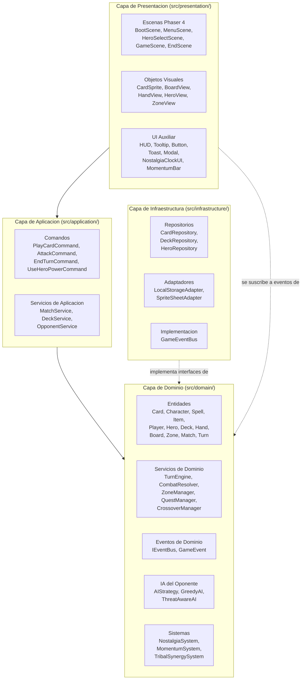
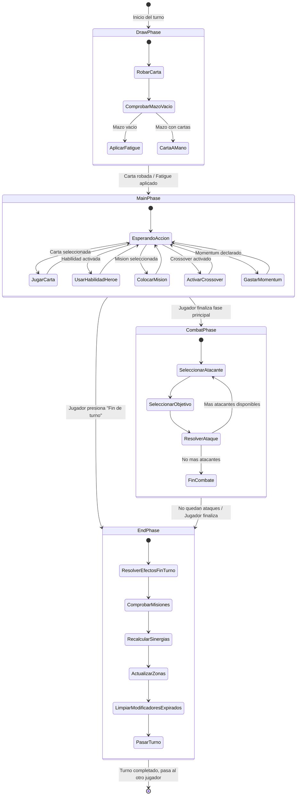
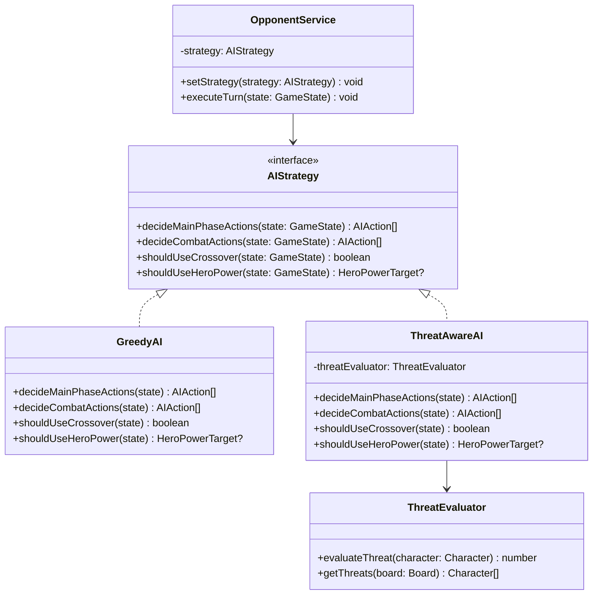
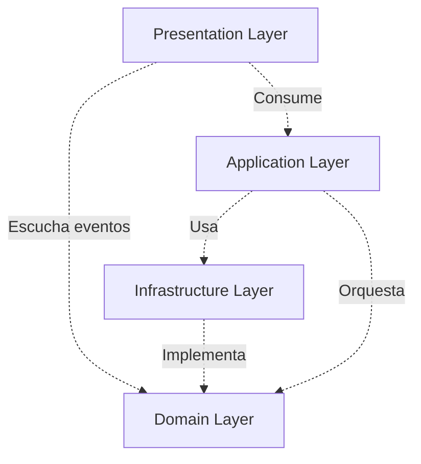

# Documento de Arquitectura Tecnica

## Crossover Cards — Juego de Cartas Estrategico por Turnos

> **Nota de actualización (2026-05-21)**: en este documento se ha aplicado
> el cambio terminológico "Criatura → Personaje / Creature → Character"
> acordado en `docs/04-card-catalog.md`. Mantiene retrocompatibilidad
> conceptual; las descripciones funcionales y mecánicas son idénticas a
> versiones anteriores del documento.

---

| Campo    | Valor                                                       |
| -------- | ----------------------------------------------------------- |
| Titulo   | Arquitectura Tecnica — Crossover Cards                      |
| Version  | 1.0.0                                                       |
| Fecha    | 2026-05-20                                                  |
| Estado   | Aprobado                                                    |
| Autores  | Equipo del proyecto (2 personas)                            |
| Fase     | Diseno (Cascada, Dia 3-4)                                   |
| Revision | Generado con asistencia de Google Antigravity (Claude Opus) |

---

## Tabla de Contenidos

1. Introduccion
2. Vision general de la arquitectura
3. Capas en detalle
4. Patrones de diseno aplicados
5. Modelo de datos
6. Maquina de estados del turno
7. Manejo de eventos (Event Bus)
8. Estrategia de IA del rival
9. Manejo de errores
10. Estrategia de testing
11. SOLID en este proyecto
12. Estructura final de carpetas
13. Dependencias entre capas
14. Despliegue
15. Riesgos arquitectonicos y mitigacion
16. ADRs derivados

---

## 1. Introduccion

### 1.1 Proposito del Documento

Este documento define la arquitectura tecnica completa del juego Crossover Cards. Su objetivo
es servir como guia exhaustiva para la fase de Implementacion, estableciendo las decisiones
de diseno, patrones, estructura de carpetas, modelo de datos y estrategias de testing que
el equipo debe seguir durante el desarrollo.

El documento traduce los requisitos funcionales y no funcionales del PRD en una
arquitectura software concreta, aplicando principios de Clean Architecture, SOLID y
patrones de diseno clasicos adaptados al contexto de un videojuego web con Phaser 4.

### 1.2 Alcance

Este documento cubre:

- Arquitectura en capas con responsabilidades detalladas de cada capa.
- Patrones de diseno aplicados con justificacion y pseudocodigo.
- Modelo de datos completo (esquemas JSON y TypeScript).
- Maquina de estados del turno.
- Sistema de eventos para comunicacion desacoplada.
- Estrategia de IA del oponente.
- Manejo de errores por capa.
- Estrategia de testing y cobertura.
- Aplicacion de principios SOLID con ejemplos concretos.
- Estructura de carpetas final del proyecto.

Este documento NO cubre: diseno visual de assets, implementacion de codigo final,
ni planificacion de tareas diarias.

### 1.3 Referencias

| Documento                          | Ubicacion                                     |
| ---------------------------------- | --------------------------------------------- |
| PRD v1.1.0                         | `docs/01-prd.md`                              |
| AGENTS.md (reglas para agentes IA) | `AGENTS.md`                                   |
| ADR-001: Stack tecnologico         | `docs/decisions/ADR-001-stack-tecnologico.md` |
| ADR-002: Tamano de bundle          | `docs/decisions/ADR-002-bundle-size.md`       |
| ADR-003: AGENTS.md y rules         | `docs/decisions/ADR-003-agents-md-y-rules.md` |
| Registro de interacciones con IA   | `docs/ai-log.md`                              |

---

## 2. Vision general de la arquitectura

### 2.1 Resumen Ejecutivo

Crossover Cards adopta una arquitectura en cuatro capas inspirada en Clean Architecture,
adaptada al contexto de un videojuego web con Phaser 4. La capa de Dominio encapsula
toda la logica pura del juego (reglas, combate, turnos, mecanicas) sin ninguna dependencia
de Phaser ni de librerias externas, lo que permite testarla con Vitest puro y garantiza
que el nucleo del juego sea independiente del motor grafico.

La capa de Aplicacion orquesta los casos de uso mediante el patron Command, traduciendo
las acciones del jugador en operaciones sobre el dominio. La capa de Infraestructura
implementa los adaptadores de datos (repositorios JSON, localStorage). La capa de
Presentacion contiene exclusivamente las escenas de Phaser 4 y los componentes visuales,
suscribiendose a eventos del dominio para reflejar los cambios de estado en pantalla.
La comunicacion entre capas se realiza mediante un Event Bus cuya interfaz reside en el
dominio (inversion de dependencias), garantizando que el flujo de dependencias siempre
apunte hacia el interior.

### 2.2 Diagrama de Capas



### 2.3 Principios Arquitectonicos Aplicados

| Principio                      | Descripcion                                                                                                               | Aplicacion en el proyecto                                                                                                                                           |
| ------------------------------ | ------------------------------------------------------------------------------------------------------------------------- | ------------------------------------------------------------------------------------------------------------------------------------------------------------------- |
| Clean Architecture             | Las dependencias apuntan hacia el interior. Las capas externas dependen de las internas, nunca al reves.                  | Domain no importa nada de Application, Infrastructure ni Presentation.                                                                                              |
| SOLID                          | Cinco principios de diseno orientado a objetos (detalle en seccion 11).                                                   | Aplicados sistematicamente en todas las capas.                                                                                                                      |
| DDD Ligero                     | Uso de entidades de dominio, value objects, eventos de dominio y servicios de dominio sin la complejidad completa de DDD. | Entidades como Card, Hero, Match encapsulan logica de negocio. Eventos de dominio comunican cambios de estado.                                                      |
| Separacion logica/presentacion | La logica del juego es completamente independiente del motor grafico.                                                     | `src/domain/` no tiene ninguna referencia a Phaser. Testeable con Vitest puro.                                                                                      |
| Inversion de Dependencias      | Las capas internas definen interfaces; las externas las implementan.                                                      | `IEventBus` definido en `src/domain/events/`, implementado en `src/infrastructure/events/`. `ICardRepository` definido en dominio, implementado en infraestructura. |
| Composicion sobre herencia     | Se prefiere composicion de comportamientos sobre jerarquias de herencia profundas.                                        | Modifier[] en Character para buffs/debuffs. AIStrategy como interfaz inyectable.                                                                                    |

### 2.4 Justificacion de Decisiones Arquitectonicas Principales

**Por que cuatro capas y no tres**: la separacion de Infraestructura como capa propia
(en lugar de mezclarla con Aplicacion) permite aislar completamente los origenes de
datos. Si en el futuro se migrase de JSON local a una API REST, solo cambiaria la
capa de Infraestructura sin tocar Aplicacion ni Dominio.

**Por que un Event Bus propio y no los eventos de Phaser**: los eventos de Phaser estan
acoplados al motor grafico. Un Event Bus de dominio propio permite que la logica de
negocio emita eventos sin conocer quien los consume, manteniendo la capa de Dominio
libre de dependencias externas (ver ADR-005).

**Por que el patron Command para acciones del jugador**: cada accion del jugador
(jugar carta, atacar, usar habilidad) se encapsula como un objeto Command. Esto permite
validar, ejecutar y potencialmente deshacer acciones de forma uniforme, ademas de
facilitar el logging y la reproduccion de partidas para testing.

**Por que Strategy para la IA**: al encapsular cada nivel de dificultad como una estrategia
independiente, se pueden anadir nuevos niveles sin modificar el codigo existente (Open/Closed
Principle). La IA Greedy y la ThreatAware comparten la misma interfaz pero difieren en
su algoritmo de decision.

---

## 3. Capas en detalle

### 3.1 Capa de Dominio (`src/domain/`)

**Responsabilidad**: contiene toda la logica pura del juego. Reglas de combate, sistema
de turnos, mecanicas innovadoras (M1-M5), calculo de sinergias y logica de la IA. Esta
capa NO tiene ninguna dependencia de Phaser, Vite ni librerias externas. Todo su codigo
es testeable con Vitest puro en Node.js.

#### 3.1.1 Entidades principales

| Entidad     | Responsabilidad                                                                                                                                                 | Archivo previsto |
| ----------- | --------------------------------------------------------------------------------------------------------------------------------------------------------------- | ---------------- |
| Card        | Clase base abstracta para todas las cartas. Define atributos comunes: id, name, type, archetype, nostalgyCost, rarity, description, spriteKey, greetingText.    | `card.ts`        |
| Character   | Extiende Card. Representa una carta de Personaje con attack, health, currentHealth, abilities, hasAttackedThisTurn, isExhausted y modifiers[].                  | `character.ts`   |
| Spell       | Extiende Card. Representa un Hechizo con effectType, targetType, effectValue.                                                                                   | `spell.ts`       |
| Item        | Extiende Card. Representa un Objeto con targetType, statModifier, abilityGranted, durability.                                                                   | `item.ts`        |
| Player      | Agrupa el estado de un jugador: hero, deck, hand, board (lado del tablero), graveyard, momentum, nostalgiaMax, nostalgiaCurrent, hasUsedCrossover, activeQuest. | `player.ts`      |
| Hero        | Heroe del jugador con id, name, maxHealth, currentHealth, heroPower, archetype, hasUsedHeroPowerThisTurn, equippedItem.                                         | `hero.ts`        |
| Deck        | Coleccion ordenada de cartas. Metodos: shuffle(), draw(), removeCard(id), size(), isEmpty().                                                                    | `deck.ts`        |
| Hand        | Coleccion de cartas en mano. Metodos: add(card), remove(id), isFull(), size(). Limite: 10 cartas.                                                               | `hand.ts`        |
| Board       | Tablero completo con 3 zonas (izquierda, centro, derecha) + 1 slot libre. Maximo 7 Personajes por lado.                                                         | `board.ts`       |
| Zone        | Una de las 3 zonas del tablero. Contiene hasta 2 Personajes por bando y un Environment activo.                                                                  | `zone.ts`        |
| Environment | Entorno activo de una zona: id, nombre, efecto (buff/debuff).                                                                                                   | `environment.ts` |
| Match       | Estado completo de una partida: player1, player2, currentTurn, turnNumber, currentPhase, winner, isFinished, turnCompletionCounter (para cambio de entornos).   | `match.ts`       |
| Turn        | Representa el turno actual: activePlayer, phase, turnNumber.                                                                                                    | `turn.ts`        |
| Quest       | Carta de mision: id, name, condition, progressCurrent, progressTarget, reward, isCompleted.                                                                     | `quest.ts`       |
| Modifier    | Value object para buffs/debuffs temporales: source, attackBonus, healthBonus, abilitiesGranted[], duration, apply(character), isExpired().                      | `modifier.ts`    |

#### 3.1.2 Servicios de dominio

| Servicio            | Responsabilidad                                                                                                                               | Archivo previsto                    |
| ------------------- | --------------------------------------------------------------------------------------------------------------------------------------------- | ----------------------------------- |
| TurnEngine          | Maquina de estados del turno. Gestiona las transiciones entre DrawPhase, MainPhase, CombatPhase y EndPhase. Implementa el patron State.       | `services/turn-engine.ts`           |
| CombatResolver      | Resuelve ataques entre Personajes y contra heroes. Aplica dano mutuo, gestiona Provocacion, Escudo Divino, Veneno, Ultimo Aliento.            | `services/combat-resolver.ts`       |
| ZoneManager         | Gestiona las 3 zonas del tablero: asignacion de Personajes a zonas, cambio de entornos cada 3 turnos, aplicacion de buffs/debuffs de entorno. | `services/zone-manager.ts`          |
| QuestManager        | Gestiona las misiones: colocacion, seguimiento de progreso, activacion de recompensas, validacion de restricciones.                           | `services/quest-manager.ts`         |
| CrossoverManager    | Gestiona la mecanica M5: validacion de uso unico, seleccion aleatoria de carta del mazo rival, transferencia a la mano.                       | `services/crossover-manager.ts`     |
| NostalgiaSystem     | Gestiona el recurso Nostalgia: incremento de maximo por turno, recarga al inicio del turno, gasto al jugar cartas.                            | `services/nostalgia-system.ts`      |
| MomentumSystem      | Gestiona el sistema de Momentum: activacion bajo 15 PV, acumulacion, conversion a Nostalgia adicional.                                        | `services/momentum-system.ts`       |
| TribalSynergySystem | Calcula y aplica bonuses de sinergia tribal segun Personajes del mismo arquetipo en el tablero.                                               | `services/tribal-synergy-system.ts` |
| CardFactory         | Patron Factory: instancia entidades Card (Character, Spell, Item) a partir de datos JSON.                                                     | `factories/card-factory.ts`         |

#### 3.1.3 Eventos de dominio (`src/domain/events/`)

La interfaz `IEventBus` y todos los tipos de eventos viven en esta subcarpeta. La capa
de dominio define QUE eventos existen y su payload, sin saber QUIEN los consume.

| Evento                 | Payload                                                        | Momento de emision                    |
| ---------------------- | -------------------------------------------------------------- | ------------------------------------- |
| CardPlayed             | { playerId, card, zoneId? }                                    | Al jugar una carta desde la mano      |
| CharacterSummoned      | { playerId, character, zoneId }                                | Al colocar un Personaje en el tablero |
| SpellCast              | { playerId, spell, targetId }                                  | Al lanzar un hechizo                  |
| ItemEquipped           | { playerId, item, targetId }                                   | Al equipar un objeto                  |
| AttackDeclared         | { attackerId, defenderId }                                     | Al declarar un ataque                 |
| AttackResolved         | { attackerId, defenderId, damageToAttacker, damageToDefender } | Al resolver el dano mutuo             |
| CharacterDestroyed     | { playerId, character, cause }                                 | Al destruir un Personaje (VID <= 0)   |
| HeroDamaged            | { playerId, damage, currentHealth }                            | Al recibir dano el heroe              |
| HeroHealed             | { playerId, amount, currentHealth }                            | Al curarse el heroe                   |
| TurnStarted            | { playerId, turnNumber, phase }                                | Al comenzar un turno                  |
| PhaseChanged           | { playerId, previousPhase, newPhase }                          | Al cambiar de fase dentro del turno   |
| TurnEnded              | { playerId, turnNumber }                                       | Al finalizar un turno                 |
| NostalgiaChanged       | { playerId, current, max }                                     | Al cambiar la Nostalgia disponible    |
| MomentumChanged        | { playerId, momentum, isActive }                               | Al cambiar el Momentum                |
| SynergyUpdated         | { playerId, archetype, bonus, affectedCharacters[] }           | Al recalcular sinergias tribales      |
| ZoneEnvironmentChanged | { zoneId, previousEnv, newEnv }                                | Al cambiar el entorno de una zona     |
| QuestPlaced            | { playerId, quest }                                            | Al colocar una mision                 |
| QuestProgressUpdated   | { playerId, questId, current, target }                         | Al avanzar el progreso de una mision  |
| QuestCompleted         | { playerId, questId, reward }                                  | Al completar una mision               |
| CrossoverActivated     | { playerId, stolenCard, wasDestroyed }                         | Al usar Crossover                     |
| HeroPowerUsed          | { playerId, heroPower, targetId? }                             | Al usar la habilidad de heroe         |
| MatchStarted           | { player1Id, player2Id }                                       | Al comenzar la partida                |
| MatchEnded             | { winnerId, loserId, isDraw }                                  | Al terminar la partida                |
| DeckEmpty              | { playerId, fatigueDamage }                                    | Al intentar robar de un mazo vacio    |

#### 3.1.4 IA del oponente (`src/domain/ai/`)

| Clase/Interfaz        | Responsabilidad                                                                                                                                |
| --------------------- | ---------------------------------------------------------------------------------------------------------------------------------------------- |
| AIStrategy (interfaz) | Define el contrato para cualquier estrategia de IA: decidePhasePrincipal(gameState), decidePhaseCombat(gameState), decideCrossover(gameState). |
| GreedyAI              | Implementa AIStrategy con algoritmo codicioso: juega cartas de mayor a menor coste, ataca al heroe si puede.                                   |
| ThreatAwareAI         | Implementa AIStrategy con evaluacion de amenazas: prioriza eliminar amenazas, aprovecha sinergias, usa Crossover defensivamente.               |
| ThreatEvaluator       | Servicio auxiliar que calcula la puntuacion de amenaza de cada Personaje enemiga.                                                              |
| AIActionPlanner       | Planifica la secuencia de acciones optima dada una estrategia y un estado de juego.                                                            |

### 3.2 Capa de Aplicacion (`src/application/`)

**Responsabilidad**: orquestacion de casos de uso. Recibe las acciones del jugador
(o de la IA), las traduce en comandos sobre el dominio, y coordina la ejecucion.
No contiene logica de negocio propia; toda la logica reside en el dominio.

#### 3.2.1 Comandos (patron Command)

Cada accion del jugador se encapsula como un objeto Command con metodo `execute()`.
Todos los comandos implementan la interfaz `ICommand`.

| Comando                  | Responsabilidad                          | Validaciones                                                                    |
| ------------------------ | ---------------------------------------- | ------------------------------------------------------------------------------- |
| PlayCardCommand          | Jugar una carta desde la mano.           | Fase correcta, Nostalgia suficiente, tablero no lleno, carta en mano.           |
| AttackCommand            | Atacar con un Personaje.                 | Fase de combate, Personaje no exhausta, objetivo valido, Provocacion respetada. |
| EndTurnCommand           | Finalizar el turno voluntariamente.      | Fase Principal o Combate activa.                                                |
| UseHeroPowerCommand      | Activar la habilidad del heroe.          | Fase Principal, Nostalgia suficiente, no usada este turno.                      |
| ActivateQuestCommand     | Colocar una mision en la zona de mision. | No hay mision activa, carta de mision en mano, inicio de Fase Principal.        |
| ActivateCrossoverCommand | Usar la mecanica Crossover.              | Fase Principal, no usado en la partida, mazo enemigo no vacio.                  |
| UseMomentumCommand       | Gastar Momentum como Nostalgia.          | Jugador en estado Momentum, Momentum disponible > 0.                            |

#### 3.2.2 Servicios de aplicacion

| Servicio        | Responsabilidad                                                                                                                                                                                                          |
| --------------- | ------------------------------------------------------------------------------------------------------------------------------------------------------------------------------------------------------------------------ |
| MatchService    | Coordina el ciclo de vida completo de la partida: inicializacion (barajar mazos, repartir cartas, elegir primer jugador), bucle de turnos, deteccion de fin de partida. Recibe comandos y los ejecuta contra el dominio. |
| DeckService     | Coordina la construccion de mazos a partir de los repositorios. Valida restricciones de deckbuilding (copias por rareza, tamano 30).                                                                                     |
| OpponentService | Gestiona el turno de la IA: recibe el estado de juego, invoca la AIStrategy configurada, traduce las decisiones de la IA en comandos que ejecuta secuencialmente con retardo artificial.                                 |

#### 3.2.3 Flujo de acciones del jugador

```
Jugador hace clic en carta (Presentacion)
  -> GameScene detecta el evento de input
  -> GameScene llama a MatchService.handlePlayerAction(action)
  -> MatchService crea PlayCardCommand con los datos de la accion
  -> PlayCardCommand.execute() valida y modifica el estado del dominio
  -> El dominio emite eventos (CardPlayed, CharacterSummoned, NostalgiaChanged...)
  -> La presentacion, suscrita a esos eventos, actualiza la UI
```

### 3.3 Capa de Infraestructura (`src/infrastructure/`)

**Responsabilidad**: implementacion tecnica de los adaptadores definidos como interfaces
en el dominio. Acceso a datos, persistencia y mapeo de recursos.

#### 3.3.1 Repositorios

| Repositorio           | Interfaz de dominio    | Implementacion            | Origen de datos                 |
| --------------------- | ---------------------- | ------------------------- | ------------------------------- |
| CardRepository        | ICardRepository        | JsonCardRepository        | `assets/data/cards.json`        |
| DeckRepository        | IDeckRepository        | JsonDeckRepository        | `assets/data/decks.json`        |
| HeroRepository        | IHeroRepository        | JsonHeroRepository        | `assets/data/heroes.json`       |
| EnvironmentRepository | IEnvironmentRepository | JsonEnvironmentRepository | `assets/data/environments.json` |
| QuestRepository       | IQuestRepository       | JsonQuestRepository       | `assets/data/quests.json`       |

#### 3.3.2 Adaptadores

| Adaptador           | Responsabilidad                                                                                                                                           |
| ------------------- | --------------------------------------------------------------------------------------------------------------------------------------------------------- |
| LocalStorageAdapter | Lee y escribe estadisticas de partida en `localStorage` del navegador. Funcionalidad opcional (CH-02). Implementa interfaz `IStorageAdapter` del dominio. |
| SpriteSheetAdapter  | Mapea los `spriteKey` de las cartas a las coordenadas/frames del spritesheet de Phaser. Puente entre datos de dominio y assets graficos.                  |

#### 3.3.3 Implementacion del Event Bus

La clase `GameEventBus` vive en `src/infrastructure/events/` e implementa la interfaz
`IEventBus` definida en `src/domain/events/`. Es un Singleton controlado que gestiona
las suscripciones y publicaciones de eventos.

#### 3.3.4 Politica de errores

Los errores en la capa de infraestructura se envuelven en `InfrastructureError` con
informacion del origen (archivo no encontrado, JSON malformado, localStorage no disponible).
La capa de aplicacion captura estos errores y los traduce en mensajes comprensibles.

### 3.4 Capa de Presentacion (`src/presentation/`)

**Responsabilidad**: capa Phaser 4. Todo lo visual: escenas, sprites, animaciones,
sonidos, UI. Solo conoce la capa de aplicacion (nunca llama directamente al dominio).
Se suscribe a los eventos del dominio a traves del Event Bus para reflejar cambios.

#### 3.4.1 Escenas

| Escena          | Responsabilidad                                                                         | Transiciones                |
| --------------- | --------------------------------------------------------------------------------------- | --------------------------- |
| BootScene       | Carga de assets: spritesheets, fuentes, sonidos, datos JSON. Muestra barra de progreso. | -> MenuScene                |
| MenuScene       | Menu principal con boton "Nueva Partida" y selector de dificultad.                      | -> HeroSelectScene          |
| HeroSelectScene | Seleccion de heroe con preview visual y descripcion de habilidad y mazo.                | -> GameScene / <- MenuScene |
| GameScene       | Tablero de juego completo. Escena principal de la partida.                              | -> EndScene                 |
| EndScene        | Pantalla de resultado: victoria, derrota o empate con estadisticas.                     | -> MenuScene                |

#### 3.4.2 Objetos visuales (`src/presentation/objects/`)

| Objeto           | Responsabilidad                                                                                                                                   |
| ---------------- | ------------------------------------------------------------------------------------------------------------------------------------------------- |
| CardSprite       | Representacion visual de una carta. Muestra arte, coste, ATQ, VID, rareza, nombre. Gestiona animaciones de hover, seleccion, juego y destruccion. |
| BoardView        | Representacion del tablero completo con las 3 zonas visuales superpuestas + slot libre. Gestiona la disposicion de Personajes.                    |
| HandView         | Representacion de la mano del jugador. Anima la entrada/salida de cartas. Gestiona el abanico de cartas.                                          |
| HeroView         | Representacion del heroe: retrato, barra de vida, boton de habilidad, objeto equipado.                                                            |
| ZoneView         | Representacion visual de una zona del tablero. Muestra el entorno activo con color/textura de fondo. Anima transiciones de entorno.               |
| NostalgiaClockUI | Reloj de bolsillo victoriano que representa la Nostalgia disponible. Anima la recarga al inicio del turno.                                        |
| MomentumBar      | Barra de Momentum junto al heroe. Muestra puntos acumulados y estado activo/inactivo.                                                             |

#### 3.4.3 UI auxiliar (`src/presentation/ui/`)

| Componente   | Responsabilidad                                                                                                              |
| ------------ | ---------------------------------------------------------------------------------------------------------------------------- |
| HUD          | Panel superior con informacion de turno activo, numero de turno, cartas en mazo, boton de fin de turno y boton de Crossover. |
| Tooltip      | Ventana emergente al pasar el cursor sobre una carta o Personaje. Muestra estadisticas completas.                            |
| Button       | Componente de boton reutilizable con estados (normal, hover, pressed, disabled).                                             |
| Toast        | Mensaje temporal que aparece y desaparece con animacion. Para notificaciones de juego.                                       |
| Modal        | Dialogo modal para confirmaciones (jugar carta, activar Crossover).                                                          |
| QuestTracker | Panel que muestra la mision activa con barra de progreso.                                                                    |
| ActionLog    | Historial lateral de acciones del turno (funcionalidad SH-05).                                                               |
| EasterEggTV  | Television retro interactiva para el easter egg. Gestiona contador de clics y secuencia de activacion.                       |

#### 3.4.4 Suscripcion a eventos del dominio

La capa de presentacion se suscribe a eventos del dominio mediante el Event Bus.
Cada objeto visual se registra a los eventos relevantes durante su inicializacion
y se desregistra al ser destruido.

```
// Pseudocodigo: GameScene se suscribe a eventos
eventBus.on(GameEvent.CharacterSummoned, (payload) => {
  boardView.addCharacterSprite(payload.character, payload.zoneId);
  handView.removeCard(payload.character.id);
});

eventBus.on(GameEvent.AttackResolved, (payload) => {
  boardView.playAttackAnimation(payload.attackerId, payload.defenderId);
  boardView.updateHealth(payload.attackerId, payload.damageToAttacker);
  boardView.updateHealth(payload.defenderId, payload.damageToDefender);
});

eventBus.on(GameEvent.ZoneEnvironmentChanged, (payload) => {
  zoneViews[payload.zoneId].transitionToEnvironment(payload.newEnv);
});
```

#### 3.4.5 Emision de acciones del jugador

La presentacion captura los inputs del jugador y los traduce en llamadas a la capa
de aplicacion. Nunca modifica el estado del dominio directamente.

```
// Pseudocodigo: CardSprite al hacer clic
cardSprite.on("pointerdown", () => {
  modal.showConfirmation(card, () => {
    matchService.handlePlayerAction({
      type: "PLAY_CARD",
      playerId: currentPlayer.id,
      cardId: card.id,
      zoneId: selectedZone?.id
    });
  });
});
```

#### 3.4.6 Renderizado de zonas

El tablero se renderiza como un area unica con zonas logicas superpuestas. Cada zona
se distingue visualmente mediante un area marcada con color tenue, textura de fondo
o borde sutil. Esta decision simplifica la implementacion en Phaser y mantiene
la mecanica clara sin requerir carriles separados fisicamente.

Distribucion de slots:

- Zona Izquierda: 2 slots por bando.
- Zona Centro: 2 slots por bando.
- Zona Derecha: 2 slots por bando.
- Slot libre (fuera de zonas): 1 slot por bando.
- Total: 7 slots por bando (cumple el limite del PRD, RF-044).

---

## 4. Patrones de diseno aplicados

### 4.1 State — Maquina de estados del turno

**Problema que resuelve**: el turno de cada jugador atraviesa 4 fases secuenciales
(Robo, Principal, Combate, Fin). Cada fase permite acciones distintas y tiene reglas
de transicion especificas. Sin patron State, la logica se concentraria en condicionales
anidados dificiles de mantener y extender.

**Donde se aplica**: `TurnEngine` en `src/domain/services/turn-engine.ts` y las clases
de fase en `src/domain/states/`.

**Clases concretas**: `ITurnPhase` (interfaz), `DrawPhase`, `MainPhase`, `CombatPhase`,
`EndPhase`, `TurnEngine` (contexto).



**Pseudocodigo**:

```
interface ITurnPhase {
  enter(context: TurnEngine): void
  handleAction(action: PlayerAction, context: TurnEngine): Result
  exit(context: TurnEngine): void
  getAllowedActions(): ActionType[]
}

class TurnEngine {
  private currentPhase: ITurnPhase
  private match: Match

  transitionTo(phase: ITurnPhase): void {
    this.currentPhase.exit(this)
    this.currentPhase = phase
    this.currentPhase.enter(this)
  }

  handleAction(action: PlayerAction): Result {
    return this.currentPhase.handleAction(action, this)
  }
}

class MainPhase implements ITurnPhase {
  enter(context: TurnEngine): void {
    // Incrementar Nostalgia, recargar, comprobar Momentum
  }
  handleAction(action: PlayerAction, context: TurnEngine): Result {
    // Validar que la accion es permitida en esta fase
    // Ejecutar el comando correspondiente
  }
  getAllowedActions(): ActionType[] {
    return [PLAY_CARD, USE_HERO_POWER, ACTIVATE_QUEST, ACTIVATE_CROSSOVER,
            USE_MOMENTUM, END_PHASE]
  }
}
```

### 4.2 Command — Acciones del jugador

**Problema que resuelve**: las acciones del jugador son variadas (jugar carta, atacar,
usar habilidad, Crossover) y cada una requiere validacion, ejecucion y potencialmente
deshacerse o registrarse. Sin Command, la logica estaria dispersa en multiples metodos
sin estructura comun.

**Donde se aplica**: `src/application/commands/`.

**Clases concretas**: `ICommand` (interfaz), `PlayCardCommand`, `AttackCommand`,
`EndTurnCommand`, `UseHeroPowerCommand`, `ActivateQuestCommand`,
`ActivateCrossoverCommand`, `UseMomentumCommand`.

**Pseudocodigo**:

```
interface ICommand {
  execute(): CommandResult
  // undo(): void — reservado para futuras iteraciones
}

interface CommandResult {
  success: boolean
  error?: DomainError
  events: GameEvent[]
}

class PlayCardCommand implements ICommand {
  constructor(
    private match: Match,
    private playerId: string,
    private cardId: string,
    private zoneId?: string
  ) {}

  execute(): CommandResult {
    const player = this.match.getPlayer(this.playerId)
    const card = player.hand.findCard(this.cardId)

    // Validaciones
    if (!card) return { success: false, error: CardNotInHand }
    if (player.nostalgiaCurrent < card.nostalgyCost)
      return { success: false, error: InsufficientNostalgia }
    if (card.type === "Character" && player.board.isFull())
      return { success: false, error: BoardFull }

    // Ejecucion
    player.hand.remove(card.id)
    player.nostalgiaCurrent -= card.nostalgyCost

    if (card.type === "Character") {
      player.board.addCharacter(card, this.zoneId)
      card.isExhausted = !card.abilities.includes("Charge")
      // Activar Battlecry si tiene
      // Recalcular sinergias tribales
    }

    return { success: true, events: [CardPlayed, ...] }
  }
}
```

### 4.3 Strategy — IA del oponente

**Problema que resuelve**: se necesitan dos niveles de dificultad de IA (Facil/Medio)
con algoritmos de decision distintos pero la misma interfaz. Debe ser posible anadir
nuevos niveles sin modificar el codigo existente.

**Donde se aplica**: `src/domain/ai/`.

**Clases concretas**: `AIStrategy` (interfaz), `GreedyAI`, `ThreatAwareAI`.



### 4.4 Observer / Event Bus — Comunicacion desacoplada

**Problema que resuelve**: el dominio necesita notificar cambios de estado (carta jugada,
ataque resuelto, mision completada) a la presentacion sin conocerla. Sin Event Bus,
el dominio tendria dependencias directas de Phaser, violando la arquitectura en capas.

**Donde se aplica**: interfaz en `src/domain/events/`, implementacion en
`src/infrastructure/events/`, suscriptores en `src/presentation/`.

**Clases concretas**: `IEventBus` (interfaz), `GameEventBus` (implementacion Singleton),
`GameEvent` (enum de tipos de evento).

**Pseudocodigo**:

```
interface IEventBus {
  on<T>(event: GameEvent, handler: (payload: T) => void): Unsubscribe
  emit<T>(event: GameEvent, payload: T): void
  off(event: GameEvent, handler: Function): void
  clear(): void
}

type Unsubscribe = () => void

class GameEventBus implements IEventBus {
  private static instance: GameEventBus | null = null
  private handlers: Map<GameEvent, Set<Function>> = new Map()
  private emitting: boolean = false  // Prevencion de bucles infinitos

  static getInstance(): GameEventBus { ... }
  static resetInstance(): void { ... }  // Para tests

  on<T>(event: GameEvent, handler: (payload: T) => void): Unsubscribe {
    // Registrar handler, devolver funcion de desuscripcion
  }

  emit<T>(event: GameEvent, payload: T): void {
    if (this.emitting) {
      console.warn("Emision recursiva detectada para", event)
      return  // Prevencion de bucles infinitos
    }
    this.emitting = true
    try {
      // Ejecutar handlers en orden de registro
      // Capturar errores individuales sin detener la propagacion
    } finally {
      this.emitting = false
    }
  }
}
```

### 4.5 Factory — Instanciacion de cartas

**Problema que resuelve**: las cartas se definen como datos JSON pero necesitan
instanciarse como objetos TypeScript tipados (Character, Spell, Item) con comportamiento.
Sin Factory, la logica de instanciacion estaria dispersa y seria propensa a errores.

**Donde se aplica**: `src/domain/factories/card-factory.ts`.

**Pseudocodigo**:

```
class CardFactory {
  static createCard(data: CardData): Card {
    switch (data.type) {
      case "Character":
        return new Character({
          ...baseCardProps(data),
          attack: data.attack,
          health: data.health,
          currentHealth: data.health,
          abilities: data.abilities ?? [],
          modifiers: [],
          isExhausted: false,
          hasAttackedThisTurn: false,
        })
      case "Spell":
        return new Spell({
          ...baseCardProps(data),
          effectType: data.effectType,
          targetType: data.targetType,
          effectValue: data.effectValue,
        })
      case "Item":
        return new Item({
          ...baseCardProps(data),
          targetType: data.targetType,
          statModifier: data.statModifier,
          abilityGranted: data.abilityGranted,
          durability: data.durability,
        })
      default:
        throw new DomainError("Tipo de carta desconocido: " + data.type)
    }
  }

  static createDeck(cardsData: CardData[]): Card[] {
    return cardsData.map(data => CardFactory.createCard(data))
  }
}
```

### 4.6 Repository — Aislamiento del origen de datos

**Problema que resuelve**: el dominio necesita acceder a datos de cartas, mazos y heroes
sin acoplarse a la forma en que estan almacenados (JSON en disco, API remota, etc.).

**Donde se aplica**: interfaces en `src/domain/repositories/`, implementaciones en
`src/infrastructure/repositories/`.

**Pseudocodigo**:

```
// Dominio: define la interfaz
interface ICardRepository {
  getAll(): Promise<CardData[]>
  getById(id: string): Promise<CardData | null>
  getByArchetype(archetype: Archetype): Promise<CardData[]>
}

// Infraestructura: implementa la interfaz
class JsonCardRepository implements ICardRepository {
  private cache: CardData[] | null = null

  async getAll(): Promise<CardData[]> {
    if (!this.cache) {
      const response = await fetch("/assets/data/cards.json")
      if (!response.ok) throw new InfrastructureError("Error cargando cards.json")
      this.cache = await response.json()
    }
    return this.cache
  }

  async getById(id: string): Promise<CardData | null> {
    const all = await this.getAll()
    return all.find(c => c.id === id) ?? null
  }
}
```

### 4.7 Singleton controlado — Event Bus y configuracion

**Problema que resuelve**: el Event Bus y la configuracion global deben tener una unica
instancia compartida por toda la aplicacion, pero deben poder resetearse en tests.

**Donde se aplica**: `GameEventBus` en `src/infrastructure/events/`, `GameConfig` en
`src/infrastructure/config/`.

**Justificacion del "controlado"**: a diferencia del Singleton clasico (irreseteaeable),
se expone un metodo `resetInstance()` que permite recrear la instancia en tests,
evitando contaminacion de estado entre tests.

### 4.8 Decorator vs Modifier[] — Modificadores temporales de cartas

**Problema que resuelve**: los Personajes pueden recibir buffs y debuffs temporales
de multiples fuentes: sinergias tribales, entornos de zona, habilidades de heroe,
efectos de cartas. Se necesita un mecanismo para aplicar y retirar estos modificadores.

#### Enfoque elegido para el MVP: Modifier[]

Para el alcance del MVP (14 dias), se adopta un enfoque basado en **composicion con
array de Modifier[]** en la entidad Character. Cada Modifier es un value object con:

```
interface IModifier {
  source: string           // Identificador del origen ("synergy", "zone", "spell")
  attackBonus: number      // Modificacion de ATQ (puede ser negativo)
  healthBonus: number      // Modificacion de VID (puede ser negativo)
  abilitiesGranted: Ability[]  // Habilidades temporales concedidas
  duration: number         // Turnos restantes (-1 = permanente)
  apply(character: Character): void
  isExpired(currentTurn: number): boolean
}

class Character extends Card {
  private modifiers: IModifier[] = []

  getEffectiveAttack(): number {
    const base = this.attack
    const bonus = this.modifiers.reduce((sum, m) => sum + m.attackBonus, 0)
    return Math.max(0, base + bonus)
  }

  addModifier(modifier: IModifier): void { ... }
  removeExpiredModifiers(currentTurn: number): void { ... }
  removeModifiersBySource(source: string): void { ... }
}
```

**Justificacion de la eleccion**: el enfoque Modifier[] es mas directo, facil de
debuggear (se inspeccionan los modifiers como datos) y suficiente para la cantidad
limitada de buffs/debuffs del MVP (sinergias tribales, 6 entornos, habilidades de heroe).
La implementacion requiere menos clases, reduce el riesgo de sobre-ingenieria y se
ajusta mejor a la restriccion temporal de 14 dias.

#### Enfoque alternativo documentado: patron Decorator

El patron Decorator envolveria la entidad Character en capas sucesivas, cada una
anadiendo o modificando comportamiento:

```
// Enfoque Decorator (NO implementado en MVP)
interface ICharacter {
  getAttack(): number
  getHealth(): number
  getAbilities(): Ability[]
}

class SynergyDecorator implements ICharacter {
  constructor(private wrapped: ICharacter, private bonus: number) {}
  getAttack(): number { return this.wrapped.getAttack() + this.bonus }
  getHealth(): number { return this.wrapped.getHealth() }
  getAbilities(): Ability[] { return this.wrapped.getAbilities() }
}
```

**Cuando se adoptaria**: si el proyecto se ampliase y la combinatoria de buffs creciese
significativamente (mas de 10 tipos de modificadores, modificadores que interactuan
entre si, orden de aplicacion relevante), el Decorator ofreceria mayor flexibilidad
para componer comportamientos. Esta decision se registra en ADR-007 como decision
tecnica futura.

### 4.9 Template Method — Fases del turno (opcional)

**Problema que resuelve**: todas las fases del turno comparten pasos comunes (validar
estado, emitir evento de entrada, ejecutar logica especifica, emitir evento de salida).

**Donde se aplica**: clase base `AbstractTurnPhase` en `src/domain/states/`.

**Pseudocodigo**:

```
  }
}
```

---

## 5. Modelo de datos

### 5.1 Esquemas JSON (Persistencia e Inicializacion)

Los datos estaticos (cartas, heroes, misiones) se almacenan en archivos JSON en la carpeta
`assets/data/`. Estos archivos se cargan en memoria y se utilizan para instanciar las entidades.

**Carta (CardData)**:

```json
{
  "id": "LIC-001",
  "name": "Pops el Gentil",
  "type": "Character",
  "archetype": "Cartoon Clasico",
  "nostalgyCost": 2,
  "rarity": "Rara",
  "description": "Ultimo Aliento: otorga +2/+2 a una Personaje aliada aleatoria",
  "spriteKey": "pops_card",
  "greetingText": "Hola, buen senor!",
  "attack": 1,
  "health": 4,
  "abilities": ["Deathrattle"]
}
```

**Mazo (DeckData)**:

```json
{
  "id": "DECK-LICH-01",
  "heroId": "HERO-001",
  "cards": [
    { "cardId": "LIC-001", "quantity": 2 },
    { "cardId": "LIC-006", "quantity": 1 }
  ]
}
```

**Heroe (HeroData)**:

```json
{
  "id": "HERO-001",
  "name": "El Lich",
  "archetype": "Aventura Magica",
  "maxHealth": 30,
  "heroPower": {
    "name": "Hechizo Ancestral",
    "cost": 2,
    "effectType": "Damage",
    "targetType": "Any",
    "value": 2
  }
}
```

**Zona / Entorno (EnvironmentData)**:

```json
{
  "id": "ENV-002",
  "name": "Bosque Magico",
  "buff": {
    "targetArchetype": "All",
    "healthBonus": 1,
    "attackBonus": 0
  }
}
```

**Mision (QuestData)**:

```json
{
  "id": "QST-001",
  "name": "El Gran Desfile",
  "condition": {
    "type": "SummonCharacters",
    "target": 5
  },
  "reward": {
    "type": "SummonToken",
    "tokenId": "TOK-001"
  }
}
```

### 5.2 Esquema TypeScript (Estado en memoria)

El estado completo de una partida en curso se representa mediante la entidad `Match`,
que agrupa todo el estado volatil.

```typescript
interface MatchState {
  id: string;
  player1: PlayerState;
  player2: PlayerState;
  currentTurn: number;
  activePlayerId: string;
  currentPhase: "Draw" | "Main" | "Combat" | "End";
  zones: ZoneState[];
  turnCompletionCounter: number;
  isFinished: boolean;
  winnerId?: string;
}

interface PlayerState {
  id: string;
  hero: HeroState;
  deck: string[]; // Lista de IDs de cartas restantes
  hand: CardState[];
  board: CharacterState[]; // Personajes en el slot libre
  graveyard: CardState[];
  nostalgiaMax: number;
  nostalgiaCurrent: number;
  momentum: number;
  isMomentumActive: boolean;
  hasUsedCrossover: boolean;
  activeQuest?: QuestState;
}

interface CharacterState extends CardState {
  currentHealth: number;
  isExhausted: boolean;
  hasAttackedThisTurn: boolean;
  modifiers: ModifierState[];
}
```

### 5.3 Estrategia de Identificadores

Segun lo definido en **ADR-006**, se adopta una estrategia hibrida para los identificadores:

- **Entidades estaticas (Cartas, Heroes, Misiones)**: Utilizan identificadores de texto
  legibles con prefijo para facilitar la edicion manual de los JSON y la referenciacion en
  el codigo (ej. `LIC-001`, `HERO-001`, `QST-001`). Esto mejora la legibilidad para el Game Designer.
- **Entidades dinamicas (Partidas, Modificadores, Instancias de cartas en partida)**: Utilizan
  UUIDs v4 autogenerados. Esto garantiza que si el jugador roba dos copias de "Pops el Gentil"
  (`LIC-001`), cada instancia de la carta tenga un identificador unico en memoria (ej.
  `550e8400-e29b-41d4-a716-446655440000`) para poder rastrearlas independientemente en el tablero y en el Event Bus.

---

## 6. Maquina de estados del turno

### 6.1 Transiciones y Eventos

Como se ilustra en el diagrama de la seccion 4.1, la maquina de estados del turno
gestiona las fases. Las transiciones ocurren debido a acciones especificas o eventos:

- **Draw -> Main**: Ocurre automaticamente tras resolver el robo de la carta inicial (o aplicar la penalizacion por _Fatigue_ si el mazo esta vacio). El sistema emite `PhaseChanged`.
- **Main -> Combat**: El jugador presiona el boton "Fase de Combate". El `TurnEngine` valida que no haya acciones bloqueantes en resolucion y efectua el cambio.
- **Combat -> End**: Ocurre de dos formas:
  1. El jugador presiona "Fin de Turno".
  2. El jugador se queda sin Personajes elegibles para atacar (todas han atacado o estan exhaustas) y el sistema transiciona automaticamente para agilizar el juego.
- **End -> Draw (Otro Jugador)**: Ocurre automaticamente tras resolver todos los efectos de fin de turno (comprobar misiones, actualizar zonas, limpiar modificadores). Se alterna `activePlayerId`.

### 6.2 Intercalacion Jugador vs IA

El bucle de juego intercala los turnos del jugador humano y la IA de forma transparente
para el `TurnEngine`.

1. **Turno del Jugador**: El `TurnEngine` entra en `MainPhase` y se queda esperando (`EsperandoAccion`). La capa de Presentacion habilita la UI para que el jugador envie comandos.
2. **Fin de Turno del Jugador**: Tras la fase End, el `TurnEngine` cambia el `activePlayerId` a la IA y pasa a `DrawPhase`.
3. **Turno de la IA**: El `MatchService` detecta que es el turno de la IA y notifica al `OpponentService`. El `TurnEngine` esta en `MainPhase` (estado `EsperandoAccion`), pero ahora en lugar de esperar input de UI, el `OpponentService` evalua el tablero usando la estrategia configurada (Greedy o Threat-Aware).
4. **Ejecucion de la IA**: El `OpponentService` despacha comandos (`PlayCardCommand`, etc.) con un retardo de `~800ms` entre cada accion para que el humano pueda visualizar las animaciones. Cuando la IA termina sus acciones, despacha `EndTurnCommand`.

---

## 7. Manejo de eventos (Event Bus)

### 7.1 Patron Publisher/Subscriber

El sistema utiliza un Event Bus (implementado como un Singleton controlado, ver seccion 4.4 y 4.7)
para desacoplar completamente la capa de Dominio de la capa de Presentacion.

- **Publisher (Dominio)**: Cuando un `Command` modifica el estado (ej. `CombatResolver` aplica daño), el dominio llama a `EventBus.emit()`.
- **Subscriber (Presentacion)**: Los `View` objects (ej. `BoardView`, `CardSprite`) se suscriben (`EventBus.on()`) durante su instanciacion y actualizan la UI al recibir los payloads.

### 7.2 Lista de Eventos y Payload

(La lista completa de eventos y su momento de emision esta tabulada en la seccion 3.1.3).

### 7.3 Garantias del Event Bus

1. **Orden de Emision Sincrono**: Los eventos se procesan de forma sincrona en el orden en que son emitidos. La UI encola las animaciones correspondientes utilizando Promesas y animaciones en cadena (Phaser Tweens) para no solapar efectos visuales contradictorios.
2. **Prevencion de Bucles Infinitos**: El `GameEventBus` mantiene un flag `isEmitting`. Si durante la ejecucion de los handlers de un evento `A`, se emite otro evento `B`, la implementacion debe encolarlo (cola de eventos) o usar un mecanismo anti-recursividad estricto para evitar `Maximum call stack size exceeded`.
3. **Aislamiento de Errores**: Si un suscriptor lanza una excepcion durante el manejo de un evento, el Event Bus captura el error (`try/catch` interno) y lo registra, pero **no interrumpe** la notificacion al resto de los suscriptores.

---

## 8. Estrategia de IA del rival

### 8.1 Estructura Intercambiable

La IA se basa en el patron Strategy (ver seccion 4.3). El `OpponentService` posee una referencia a
la interfaz `AIStrategy` y ejecuta el plan de acciones devuelto. Esto permite cambiar
la dificultad (incluso en mitad de la partida) simplemente inyectando una nueva implementacion.

### 8.2 Algoritmo GreedyAI (Nivel Facil)

Actua de forma codiciosa maximizando el valor inmediato sin prever consecuencias.

**Paso a paso en Fase Principal**:

1. Obtiene las cartas de la mano y las ordena descendentemente por coste de Nostalgia.
2. Itera la lista e intenta jugar la primera carta cuyo coste sea `<= nostalgiaCurrent`.
3. Repite hasta que no quede ninguna carta jugable.
4. Si tras jugar cartas queda Nostalgia `>=` coste del `heroPower`, lo activa seleccionando un objetivo al azar.
5. Emite transicion a Fase de Combate. (No usa Crossover ni Momentum de forma inteligente).

**Paso a paso en Fase de Combate**:

1. Obtiene las Personajes propias listas para atacar.
2. Por cada atacante:
   - Si el oponente tiene Personajes con Provocacion (Taunt), elige la de menor Vida y ataca.
   - Si no hay Provocacion, ataca al heroe oponente directamente con la Personaje de mayor ATQ.
   - Si no puede atacar al heroe, ataca a la Personaje oponente con menor Vida.
3. Al quedarse sin atacantes, termina el turno.

### 8.3 Algoritmo ThreatAwareAI (Nivel Medio)

Evalua el estado del tablero, identifica amenazas e intenta buscar intercambios ("trades") favorables.

**Evaluacion de Amenazas (ThreatEvaluator)**:
Al inicio del turno, calcula un score de peligro para cada Personaje enemiga:

- Base = ATQ + (Vida \* 0.5).
- Modificadores: Si tiene Veneno (+3), Escudo Divino (+2), Provocacion (+1).
- Si el score es `>= 5`, se considera una **Amenaza Critica**.

**Paso a paso en Fase Principal**:

1. **Defensa Temprana**: Si la vida del heroe de la IA es `<= 40%`, busca en la mano hechizos de curacion, control, o usa el **Crossover** para intentar robar un salvavidas si tiene `=< 3` cartas en mano.
2. **Activacion de Sinergias**: Busca en su mano grupos de `>= 2` cartas del mismo arquetipo. Si puede pagarlas juntas este turno, prioriza su uso para activar `TribalSynergySystem`.
3. **Resolucion Estandar**: Juega las cartas que maximicen estadisticas en el tablero, priorizando Personajes con _Battlecry_ que puedan matar Amenazas Criticas (ej. hacer 2 de dano al entrar a una amenaza con 2 de vida).
4. **Momentum**: Si la IA esta en estado de Momentum y tiene `>= 3` cargas, lo convierte a Nostalgia para jugar una carta clave.

**Paso a paso en Fase de Combate**:

1. Prioriza atacar y eliminar las **Amenazas Criticas** enemigas.
2. Busca "Value Trades": Atacar a una enemiga con una propia si la enemiga muere pero la propia sobrevive. (Ej. Mi 3/3 ataca a su 3/2 -> yo gano el trade porque mi personaje sobrevive 3/1).
3. Si hay Provocacion, usa Personajes de bajo ATQ/Vida ("basura") para "romper" Escudos Divinos o sacrificar vida antes de atacar con la Personaje fuerte.
4. Solo ataca al heroe enemigo si: No hay amenazas criticas en el tablero, o si el dano conjunto en el tablero permite letal (reducir el heroe enemigo a 0).

---

## 9. Manejo de errores

El proyecto sigue una estrategia defensiva de manejo de errores, distinguiendo claramente
entre violaciones de reglas de juego y errores de sistema.

### 9.1 Tipos de Error Propios

Todas las clases de error heredan de `Error` de JavaScript, pero se agrupan en tres categorias:

1. **`DomainError`**: Violaciones de las reglas del juego. Son esperables y recuperables.
   - Ejemplo: `InsufficientNostalgiaError`, `InvalidTargetError`, `PhaseViolationError`.
   - Politica: La capa de Aplicacion los captura en la ejecucion del `Command` y retorna `{ success: false, error }`. La Presentacion muestra un mensaje visual (ej. Toast de "Nostalgia Insuficiente") y el jugador puede intentar otra accion.
2. **`ApplicationError`**: Fallos en la orquestacion de servicios.
   - Ejemplo: `InvalidCommandError`, `PlayerNotFoundError`.
   - Politica: Suelen indicar un bug de sincronizacion. Se capturan en el `MatchService`, se logean en consola y se aborta el comando.
3. **`InfrastructureError`**: Fallos tecnicos al acceder a recursos.
   - Ejemplo: `AssetLoadError` (no se encuentra cards.json), `StorageError`.
   - Politica: Si ocurren durante la carga inicial (`BootScene`), se detiene el juego y se muestra una pantalla de error critico al usuario. Si ocurren en localStorage, se ignoran silenciosamente.

### 9.2 Logging

Para el MVP no se incluira una libreria externa de telemetria. El logging se realizara mediante un `Logger` interno (Wrapper sobre `console`) que permita filtrar niveles (INFO, WARN, ERROR) y que puede ser desactivado en produccion. Todas las transiciones de estado del `TurnEngine` y emisiones del `EventBus` (en modo debug) dejaran rastro logico.

---

## 10. Estrategia de testing

### 10.1 Piramide de Testing

El proyecto adopta una piramide de testing orientada a dar la maxima confianza al nucleo del juego con la mayor velocidad de ejecucion posible.

- **Tests Unitarios (Muchos)**: Validan la logica de negocio en `src/domain/`. Son rapidos (Vitest puro sin jsdom) y comprueban calculo de dano, transiciones de fase, sinergias y reglas estrictas.
- **Tests de Integracion (Medios)**: Validan la interaccion entre Aplicacion, Dominio e Infraestructura (ej. `MatchService` procesando un comando entero usando `JsonCardRepository` con datos de prueba). Requieren inicializar varios modulos juntos.
- **Tests E2E/Visuales (Pocos)**: Se probaran manualmente, o con herramientas basicas (cypress) si el tiempo lo permite. La capa de Presentacion de Phaser es notoriamente dificil de testear de forma automatizada por la naturaleza del canvas WebGL.

### 10.2 Cobertura Minima Objetivo

- **Capa de Dominio (`src/domain/`)**: `>= 80%`. El nucleo del juego debe ser robusto.
- **Capa de Aplicacion (`src/application/`)**: `>= 60%`. Casos de uso e instanciacion de comandos.
- **Capa de Infraestructura (`src/infrastructure/`)**: `>= 40%`. Se prueban adaptadores clave mockeando los sistemas subyacentes.
- **Capa de Presentacion (`src/presentation/`)**: Cobertura automatizada no requerida. Evaluacion manual/visual y tests minimos de inicializacion de escenas (Phaser Mocks).

### 10.3 Herramientas

- **Framework**: Vitest.
- **Entorno**: `@vitest/environment-jsdom` (solo para tests que toquen DOM o LocalStorage).
- **Cobertura**: `@vitest/coverage-v8`.
- **Mocks**: Funciones `vi.mock()` de Vitest para aislar dependencias (ej. simular la respuesta aleatoria del Crossover, o simular el EventBus). Para codigo Phaser, se usara inyeccion de dependencias o stubs simples si fuese necesario aislar la logica de UI.

---

## 11. SOLID en este proyecto

El diseño de Crossover Cards esta fundamentado en los principios SOLID para garantizar mantenibilidad.

### 11.1 Single Responsibility Principle (SRP)

_Una clase debe tener una, y solo una, razon para cambiar._

- **Ejemplo**: `CombatResolver` (solo calcula y aplica el dano de un combate) vs `TurnEngine` (solo gestiona en que fase estamos).
- **Clase que lo encarna**: `TribalSynergySystem`. Su unica razon de cambiar es si cambian las matematicas de las sinergias.

### 11.2 Open/Closed Principle (OCP)

_Las entidades deben estar abiertas para extension, pero cerradas para modificacion._

- **Ejemplo**: Para agregar un nuevo tipo de Fase de Turno o un nuevo nivel de IA, no modificamos `TurnEngine` ni `OpponentService`. Creamos nuevas clases que implementen `ITurnPhase` o `AIStrategy`.
- **Clase que lo encarna**: `AIStrategy` y sus implementaciones (`GreedyAI`, `ThreatAwareAI`).

### 11.3 Liskov Substitution Principle (LSP)

_Los objetos de un programa deberian ser reemplazables por instancias de sus subtipos sin alterar el correcto funcionamiento._

- **Ejemplo**: Las clases `Character`, `Spell` e `Item` heredan de `Card`. Cualquier funcion en el dominio que reciba una `Card` (ej. meterla en la mano `Hand.add(card)`) funciona perfectamente sin importar si la carta es de un subtipo o de otro.
- **Clase que lo encarna**: La jerarquia `Card`.

### 11.4 Interface Segregation Principle (ISP)

_Muchas interfaces cliente-especificas son mejores que una interfaz de proposito general._

- **Ejemplo**: En lugar de tener un `IGameRepository` gigante que lea cartas, mazos y heroes, separamos las interfaces en `ICardRepository`, `IDeckRepository`, etc., para que los servicios solo dependan de los datos que realmente consumen.
- **Clase que lo encarna**: Las interfaces del namespace `repositories/`.

### 11.5 Dependency Inversion Principle (DIP)

_Depender de abstracciones, no de concreciones. Las capas altas no deben depender de las bajas._

- **Ejemplo**: El `TurnEngine` no importa la base de datos ni `GameEventBus` desde `infrastructure`. Importa `IEventBus` (la interfaz abstracción) que esta definida en el propio dominio.
- **Clase que lo encarna**: La relacion entre `src/domain/events/IEventBus` y `src/infrastructure/events/GameEventBus`.

---

## 12. Estructura final de carpetas

```text
src/
├── application/
│   ├── commands/              # Patron Command (PlayCard, Attack, etc.)
│   └── services/              # Orquestacion (MatchService, OpponentService)
├── domain/
│   ├── ai/                    # Patron Strategy (GreedyAI, ThreatAwareAI)
│   ├── entities/              # Card, Hero, Player, Match, Board, etc.
│   ├── events/                # IEventBus, Event Types
│   ├── factories/             # CardFactory
│   ├── repositories/          # Interfaces (ICardRepository, etc.)
│   ├── services/              # Logica de negocio (TurnEngine, CombatResolver)
│   ├── states/                # Patron State (MainPhase, CombatPhase, etc.)
│   └── value-objects/         # Modifiers, etc.
├── infrastructure/
│   ├── adapters/              # LocalStorageAdapter, SpriteSheetAdapter
│   ├── events/                # GameEventBus (Implementacion)
│   └── repositories/          # JsonCardRepository, etc. (Implementaciones)
├── presentation/
│   ├── assets/                # Enlaces o carga a assets graficos
│   ├── objects/               # CardSprite, BoardView, HeroView
│   ├── scenes/                # BootScene, MenuScene, GameScene
│   └── ui/                    # HUD, Tooltips, Buttons
├── index.css                  # Estilos globales minimos (reset, canvas)
├── index.html                 # Punto de entrada HTML (contenedor de Phaser)
└── main.ts                    # Entry point de la aplicacion (inicializa Phaser y EventBus)
```

---

## 13. Dependencias entre capas

Regla de oro: **Las flechas de dependencia siempre apuntan hacia la capa de Dominio**.



_Nota: Aunque la teoria estricta de puertos y adaptadores diria que Aplicacion no debe conocer Infraestructura directamente, en el scope de este MVP y en el punto de entrada de la aplicacion (`main.ts` / inicializadores de `MatchService`), se inyectan las instancias de Infraestructura (los repositorios JSON concretos) en los constructores de Aplicacion. El dominio permanece 100% puro._

---

## 14. Despliegue

- **Tipo**: Aplicacion web estatica puramente de cliente. No requiere backend (toda la logica reside en el navegador).
- **Build**: Vite compila el proyecto y genera los bundles de assets y codigo en la carpeta `dist/` usando el comando `npm run build`.
- **Alojamiento**: Como son archivos estaticos (`index.html`, `.js`, `.css` y `assets/`), el proyecto es directamente desplegable en GitHub Pages (como URL estatica) o publicable en itch.io subiendo un archivo ZIP del contenido de la carpeta `dist/`.

---

## 15. Riesgos arquitectonicos y mitigacion

| ID    | Riesgo                                                                                                      | Mitigacion Arquitectonica                                                                                                                                                                                            |
| ----- | ----------------------------------------------------------------------------------------------------------- | -------------------------------------------------------------------------------------------------------------------------------------------------------------------------------------------------------------------- |
| RA-01 | **Acoplamiento logica-Phaser**. Terminar calculando dano dentro del metodo update() de Phaser.              | Mantener estricta separacion en carpetas. Codigo en `src/presentation` no puede modificar variables de estado del Dominio directamente; debe disparar un Command.                                                    |
| RA-02 | **Carrera de animaciones vs logica**. La logica se ejecuta instantaneamente, pero las animaciones tardan.   | El Event Bus actua como buffer. La logica de turnos bloquea comandos (`EsperandoAccion` -> false) si la UI notifica que esta reproduciendo animaciones.                                                              |
| RA-03 | **Complejidad de Buffs cruzados**. Multiples modificadores se pisan o no se retiran al expirar.             | Uso estricto del enfoque `Modifier[]`. Un metodo centralizado `Character.getEffectiveAttack()` recalcula el valor sumando todos los modificadores en vivo, en lugar de alterar destructivamente la estadistica base. |
| RA-04 | **Event Loop y recursividad en el Event Bus**. Un evento dispara otro que dispara el primero infinitamente. | Implementar flag `isEmitting` en el `GameEventBus`. Si ocurre reentrada, se logea error, se bloquea o se encola el evento secundario en `setTimeout()`.                                                              |
| RA-05 | **Bundle size de Phaser 4**. Superar limites aceptables para navegadores lentos o web hosting gratuito.     | Se genero ADR-002: configuracion estricta de rollup y chunks de Vite.                                                                                                                                                |

---

## 16. ADRs derivados

Como consecuencia de este diseño arquitectonico, se proponen los siguientes _Architecture Decision Records_ (ADRs) a ser generados en la carpeta `docs/decisions/` durante la fase de Implementacion.

1. **ADR-004-patron-state-turnos.md**: Documentar la justificacion detallada para utilizar el patron State sobre alternativas procedurales para las fases del turno.
2. **ADR-005-event-bus-comunicacion.md**: Justificar la implementacion de un Event Bus custom en la capa de infraestructura en lugar de depender directamente de los eventos nativos de Phaser.
3. **ADR-006-estrategia-identificadores.md**: Validacion de la estrategia hibrida (Strings legibles para data estatica, UUIDs para instancias dinamicas).
4. **ADR-007-patron-strategy-ia.md**: Documentacion de la estructura inyectable para niveles de dificultad y la decision de documentar Decorators para futura aplicacion.
