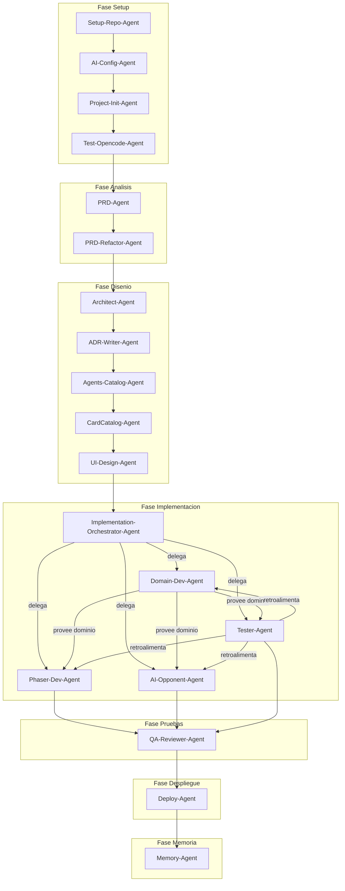

# Catálogo de Agentes — Crossover Cards

**Versión**: 1.0  
**Fecha**: 2026-05-21  
**Fase**: Diseño (días 3-4)  
**Autores**: [Vuestros nombres]  
**Estado**: En redacción

---

## 1. Introducción

### 1.1 Propósito del documento

Este documento es el catálogo formal de agentes de IA del proyecto académico "Crossover Cards". Registra todos los agentes utilizados y previstos, sus modelos asignados, sus flujos de interacción, las skills y rules que los gobiernan, y la política de gestión de tokens. Está diseñado para cumplir el requisito de la rúbrica que exige documentar todas las interacciones con herramientas de IA, y para servir como capítulo autónomo de la memoria final del proyecto.

### 1.2 Política general de uso de agentes

El proyecto adopta el principio de **supervisión humana obligatoria**: ningún agente escribe código ni modifica documentos críticos sin que el equipo haya aprobado previamente un plan. El flujo estándar es:

1. El agente propone un plan estructurado.
2. El equipo lo revisa y aprueba, rechaza o solicita ajustes.
3. El agente ejecuta el plan aprobado.
4. El equipo verifica el resultado y documenta la interacción en `docs/ai-log.md`.

Este ciclo garantiza trazabilidad completa y evita que las alucinaciones o la deriva del prompt lleguen al código base sin filtro humano.

### 1.3 Referencias

| Documento                      | Ruta                                 |
| ------------------------------ | ------------------------------------ |
| Rules globales de agentes      | `AGENTS.md`                          |
| Product Requirements Document  | `docs/01-prd.md`                     |
| Arquitectura técnica           | `docs/02-architecture.md`            |
| Registro de interacciones      | `docs/ai-log.md`                     |
| Decisiones arquitectónicas     | `docs/decisions/ADR-001` a `ADR-007` |
| Workflows ejecutables          | `.agent/workflows/*.md`              |
| Skills cargables               | `.agent/skills/*/SKILL.md`           |
| Prompts versionados (legibles) | `prompts/agents/*.md`                |

---

## 2. Visión general del sistema agéntico

### 2.1 Arquitectura dual cloud/local

El sistema agéntico del proyecto se articula en dos niveles complementarios, tal como exige el enunciado de la asignatura:

**Nivel alto — cloud (Antigravity)**

- IDE agéntico: Google Antigravity (preview gratuita).
- Modelos disponibles: Gemini 3 Flash, Gemini 3.1 Pro, Claude Sonnet 4.6 Thinking, Claude Opus 4.6 Thinking, GPT-OSS 120B Medium.
- Capacidades: razonamiento profundo, documentos largos, generación multi-archivo, memoria de conversación, soporte nativo de Workflows, Skills y Rules.
- Uso típico: arquitectura, documentación extensa, generación de código complejo, orquestación de flujos agénticos.

**Nivel bajo — local (opencode + Ollama)**

- IDE agéntico: opencode (CLI ejecutado desde la terminal integrada de Antigravity).
- Modelos disponibles: Qwen2.5-Coder-7B, Qwen3-8B, DeepSeek-R1-8B, Phi-4-mini.
- Contexto máximo efectivo: 16 384 tokens (configurado en los Modelfiles).
- Uso típico: boilerplate, tests unitarios repetitivos, refactors pequeños, tareas mecánicas sin necesidad de razonamiento profundo.

### 2.2 Principios de la arquitectura agéntica

- **División de tareas por capacidad**: las tareas que requieren razonamiento complejo, contexto extenso o múltiples archivos van siempre al nivel cloud. Las tareas mecánicas y repetitivas van al nivel local para conservar cuota.
- **Rules como contrato**: el archivo `AGENTS.md` en la raíz actúa como contrato de comportamiento para todos los agentes, independientemente de la herramienta o el modelo. Opencode lo lee automáticamente por convención; Antigravity lo carga como Rule global.
- **Skills bajo demanda**: las skills de `.agent/skills/` se cargan solo cuando la tarea las requiere, evitando el consumo innecesario de contexto.
- **Trazabilidad obligatoria**: cada interacción queda registrada en `docs/ai-log.md` con la plantilla oficial del proyecto.
- **Versionado de prompts**: los prompts ejecutables están en `.agent/workflows/`; las copias legibles, en `prompts/agents/`.

### 2.3 Justificación del enfoque dual

El enunciado de la asignatura indica explícitamente que el proyecto "ha de utilizar tanto opencode como Antigravity ya que se complementan perfectamente al actuar uno más a bajo nivel y el otro a alto nivel". La arquitectura dual adoptada cumple este requisito de forma literal:

- Antigravity actúa como el cerebro estratégico: define arquitectura, redacta documentación compleja y genera código crítico con modelos de primer nivel (Claude Opus, Gemini 3.1 Pro).
- opencode actúa como el ejecutor táctico: implementa boilerplate, tests estructurados y refactors localizados con modelos ligeros que corren en la propia máquina.

La combinación maximiza la calidad de las salidas críticas sin agotar la cuota gratuita de los modelos cloud.

---

## 3. Catálogo de agentes

El catálogo recoge 19 fichas organizadas por fase de la cascada. Las fichas #001 a #009 corresponden a agentes ya ejecutados; las fichas #010 a #019 a agentes previstos para las fases restantes.

---

### 3.1 Agentes ejecutados

#### Agente #001 — Setup-Repo-Agent

| Campo                        | Valor                                                                                                                                                                    |
| ---------------------------- | ------------------------------------------------------------------------------------------------------------------------------------------------------------------------ |
| **Nombre**                   | Setup-Repo-Agent                                                                                                                                                         |
| **Fase**                     | Setup (anterior al día 1)                                                                                                                                                |
| **Rol**                      | Agente de bootstrapping estructural. Crea la estructura de carpetas del repositorio y los archivos base de documentación sin instalar dependencias npm ni configurar IA. |
| **Modelo principal**         | Gemini 3 Flash                                                                                                                                                           |
| **Modelo respaldo 1**        | Gemini 3.1 Pro                                                                                                                                                           |
| **Modelo respaldo 2**        | Qwen3-8B (local)                                                                                                                                                         |
| **Herramienta**              | Antigravity                                                                                                                                                              |
| **Skills cargadas**          | Ninguna                                                                                                                                                                  |
| **Rules aplicables**         | AGENTS.md                                                                                                                                                                |
| **MCP Servers utilizados**   | Ninguno                                                                                                                                                                  |
| **Entradas esperadas**       | Descripción de la estructura de carpetas deseada y lista de archivos base.                                                                                               |
| **Salidas esperadas**        | 21 carpetas, 14 archivos `.gitkeep`, `README.md`, `.gitignore`, `.gitattributes`, `Grupo.txt`.                                                                           |
| **Estado actual**            | Ejecutado                                                                                                                                                                |
| **Interacción en ai-log.md** | #001                                                                                                                                                                     |
| **Prompt template**          | `.agent/workflows/setup-repo-agent.md`                                                                                                                                   |

---

#### Agente #002 — AI-Config-Agent

| Campo                        | Valor                                                                                                                                                                                                                                   |
| ---------------------------- | --------------------------------------------------------------------------------------------------------------------------------------------------------------------------------------------------------------------------------------- |
| **Nombre**                   | AI-Config-Agent                                                                                                                                                                                                                         |
| **Fase**                     | Setup (anterior al día 1)                                                                                                                                                                                                               |
| **Rol**                      | Agente de configuración de infraestructura IA. Crea la documentación de decisiones (ADR-001, ADR-002), el registro de interacciones (`ai-log.md`), la configuración de opencode con Ollama y versiona los prompts en `prompts/agents/`. |
| **Modelo principal**         | Gemini 3 Flash                                                                                                                                                                                                                          |
| **Modelo respaldo 1**        | Gemini 3.1 Pro                                                                                                                                                                                                                          |
| **Modelo respaldo 2**        | Qwen3-8B (local)                                                                                                                                                                                                                        |
| **Herramienta**              | Antigravity                                                                                                                                                                                                                             |
| **Skills cargadas**          | Ninguna                                                                                                                                                                                                                                 |
| **Rules aplicables**         | AGENTS.md                                                                                                                                                                                                                               |
| **MCP Servers utilizados**   | Ninguno                                                                                                                                                                                                                                 |
| **Entradas esperadas**       | Stack tecnológico acordado, modelos locales disponibles, estructura del repositorio existente.                                                                                                                                          |
| **Salidas esperadas**        | `docs/ai-log.md`, `ADR-001.md`, `ADR-002.md`, `opencode.json`, `Modelfile-qwen-coder`, `Modelfile-qwen3`, prompts versionados.                                                                                                          |
| **Estado actual**            | Ejecutado                                                                                                                                                                                                                               |
| **Interacción en ai-log.md** | #002                                                                                                                                                                                                                                    |
| **Prompt template**          | `.agent/workflows/ai-config-agent.md`                                                                                                                                                                                                   |

---

#### Agente #003 — Project-Init-Agent

| Campo                        | Valor                                                                                                                                                                                                               |
| ---------------------------- | ------------------------------------------------------------------------------------------------------------------------------------------------------------------------------------------------------------------- |
| **Nombre**                   | Project-Init-Agent                                                                                                                                                                                                  |
| **Fase**                     | Setup (anterior al día 1)                                                                                                                                                                                           |
| **Rol**                      | Agente de bootstrapping técnico. Inicializa el proyecto Phaser 4 + TypeScript strict + Vite + Vitest + ESLint flat config + Prettier con alias de paths para arquitectura en capas. Verifica el entorno end-to-end. |
| **Modelo principal**         | Gemini 3 Flash                                                                                                                                                                                                      |
| **Modelo respaldo 1**        | Claude Sonnet 4.6 Thinking                                                                                                                                                                                          |
| **Modelo respaldo 2**        | Qwen3-8B (local)                                                                                                                                                                                                    |
| **Herramienta**              | Antigravity (chat + terminal integrada)                                                                                                                                                                             |
| **Skills cargadas**          | Ninguna                                                                                                                                                                                                             |
| **Rules aplicables**         | AGENTS.md                                                                                                                                                                                                           |
| **MCP Servers utilizados**   | Ninguno                                                                                                                                                                                                             |
| **Entradas esperadas**       | Repositorio con estructura existente, especificación de stack del ADR-001.                                                                                                                                          |
| **Salidas esperadas**        | `package.json` (13 scripts), `tsconfig.json`, `vite.config.ts`, `vitest.config.ts`, `eslint.config.js`, `.prettierrc.json`, `index.html`, `src/main.ts`, `tests/smoke.test.ts`.                                     |
| **Estado actual**            | Ejecutado                                                                                                                                                                                                           |
| **Interacción en ai-log.md** | #003                                                                                                                                                                                                                |
| **Prompt template**          | `.agent/workflows/project-init-agent.md`                                                                                                                                                                            |

---

#### Agente #004 — Test-Opencode-Agent

| Campo                        | Valor                                                                                                                                                                                                        |
| ---------------------------- | ------------------------------------------------------------------------------------------------------------------------------------------------------------------------------------------------------------ |
| **Nombre**                   | Test-Opencode-Agent                                                                                                                                                                                          |
| **Fase**                     | Setup (anterior al día 1)                                                                                                                                                                                    |
| **Rol**                      | Agente de verificación de la infraestructura local de IA. Confirma que Ollama, los modelos personalizados y opencode son operativos, y que el agente puede leer el filesystem del repositorio correctamente. |
| **Modelo principal**         | Qwen3-8B (custom: qwen3-agent, num_ctx 16384)                                                                                                                                                                |
| **Modelo respaldo 1**        | Qwen2.5-Coder-7B (custom: qwen-coder-agent)                                                                                                                                                                  |
| **Modelo respaldo 2**        | Ninguno                                                                                                                                                                                                      |
| **Herramienta**              | opencode (CLI dentro de la terminal de Antigravity)                                                                                                                                                          |
| **Skills cargadas**          | Ninguna                                                                                                                                                                                                      |
| **Rules aplicables**         | AGENTS.md (leído automáticamente por opencode)                                                                                                                                                               |
| **MCP Servers utilizados**   | Ninguno                                                                                                                                                                                                      |
| **Entradas esperadas**       | Repositorio inicializado, Ollama corriendo con modelos custom, opencode instalado.                                                                                                                           |
| **Salidas esperadas**        | Verificación funcional (sin archivos nuevos). Limitaciones documentadas en ai-log.md.                                                                                                                        |
| **Estado actual**            | Ejecutado                                                                                                                                                                                                    |
| **Interacción en ai-log.md** | #004                                                                                                                                                                                                         |
| **Prompt template**          | No tiene workflow formal; verificación ad-hoc documentada en ai-log.md.                                                                                                                                      |

---

#### Agente #005 — PRD-Agent

| Campo                        | Valor                                                                                                                                                                                                                                  |
| ---------------------------- | -------------------------------------------------------------------------------------------------------------------------------------------------------------------------------------------------------------------------------------- |
| **Nombre**                   | PRD-Agent                                                                                                                                                                                                                              |
| **Fase**                     | Análisis de Requisitos (día 2)                                                                                                                                                                                                         |
| **Rol**                      | Product Manager senior especializado en juegos de cartas. Redacta el PRD completo: alcance MVP, mecánicas innovadoras, sistema de cartas, héroes, IA del oponente, 50 RF, 20 RNF, 8 casos de uso Cockburn y criterios Given/When/Then. |
| **Modelo principal**         | Claude Sonnet 4.6 Thinking                                                                                                                                                                                                             |
| **Modelo respaldo 1**        | Gemini 3.1 Pro                                                                                                                                                                                                                         |
| **Modelo respaldo 2**        | Gemini 3 Flash                                                                                                                                                                                                                         |
| **Herramienta**              | Antigravity                                                                                                                                                                                                                            |
| **Skills cargadas**          | Ninguna                                                                                                                                                                                                                                |
| **Rules aplicables**         | AGENTS.md                                                                                                                                                                                                                              |
| **MCP Servers utilizados**   | Ninguno                                                                                                                                                                                                                                |
| **Entradas esperadas**       | Concepto del juego, mecánicas, héroes, sistema de cartas, restricciones del enunciado.                                                                                                                                                 |
| **Salidas esperadas**        | `docs/01-prd.md` (1292 líneas, ~80 KB, 19 secciones).                                                                                                                                                                                  |
| **Estado actual**            | Ejecutado                                                                                                                                                                                                                              |
| **Interacción en ai-log.md** | #005                                                                                                                                                                                                                                   |
| **Prompt template**          | `.agent/workflows/prd-agent.md`                                                                                                                                                                                                        |

---

#### Agente #006 — PRD-Refactor-Agent

| Campo                        | Valor                                                                                                                                                                                                                                                                     |
| ---------------------------- | ------------------------------------------------------------------------------------------------------------------------------------------------------------------------------------------------------------------------------------------------------------------------- |
| **Nombre**                   | PRD-Refactor-Agent                                                                                                                                                                                                                                                        |
| **Fase**                     | Análisis de Requisitos (día 2)                                                                                                                                                                                                                                            |
| **Rol**                      | Game Designer senior. Refactoriza el PRD inicial con cambios quirúrgicos del universo Crossover Cards: recurso Nostalgia (reloj de bolsillo), héroes El Lich y Axel Blaze, 20 cartas nuevas de series de animación nostálgicas, 4 arquetipos, zonas y misiones genéricas. |
| **Modelo principal**         | Claude Sonnet 4.6 Thinking                                                                                                                                                                                                                                                |
| **Modelo respaldo 1**        | Gemini 3.1 Pro                                                                                                                                                                                                                                                            |
| **Modelo respaldo 2**        | Gemini 3 Flash                                                                                                                                                                                                                                                            |
| **Herramienta**              | Antigravity                                                                                                                                                                                                                                                               |
| **Skills cargadas**          | Ninguna                                                                                                                                                                                                                                                                   |
| **Rules aplicables**         | AGENTS.md                                                                                                                                                                                                                                                                 |
| **MCP Servers utilizados**   | Ninguno                                                                                                                                                                                                                                                                   |
| **Entradas esperadas**       | `docs/01-prd.md` existente, trasfondo de personajes embebido, lista de cambios obligatorios y secciones protegidas.                                                                                                                                                       |
| **Salidas esperadas**        | `docs/01-prd.md` actualizado con el universo Crossover Cards definitivo.                                                                                                                                                                                                  |
| **Estado actual**            | Ejecutado                                                                                                                                                                                                                                                                 |
| **Interacción en ai-log.md** | #006                                                                                                                                                                                                                                                                      |
| **Prompt template**          | `.agent/workflows/prd-refactor-agent.md`                                                                                                                                                                                                                                  |

---

#### Agente #007 — Architect-Agent

| Campo                        | Valor                                                                                                                                                                                                                                                                    |
| ---------------------------- | ------------------------------------------------------------------------------------------------------------------------------------------------------------------------------------------------------------------------------------------------------------------------ |
| **Nombre**                   | Architect-Agent                                                                                                                                                                                                                                                          |
| **Fase**                     | Diseño (días 3-4)                                                                                                                                                                                                                                                        |
| **Rol**                      | Arquitecto de software senior. Redacta el documento de arquitectura técnica con 16 secciones: capas, patrones (State, Command, Strategy, Observer, Factory, Repository), modelo de datos, máquina de estados del turno, Event Bus, estrategia de IA y diagramas Mermaid. |
| **Modelo principal**         | Claude Sonnet 4.6 Thinking                                                                                                                                                                                                                                               |
| **Modelo respaldo 1**        | Gemini 3.1 Pro                                                                                                                                                                                                                                                           |
| **Modelo respaldo 2**        | Gemini 3 Flash                                                                                                                                                                                                                                                           |
| **Herramienta**              | Antigravity                                                                                                                                                                                                                                                              |
| **Skills cargadas**          | Ninguna                                                                                                                                                                                                                                                                  |
| **Rules aplicables**         | AGENTS.md                                                                                                                                                                                                                                                                |
| **MCP Servers utilizados**   | Ninguno                                                                                                                                                                                                                                                                  |
| **Entradas esperadas**       | `docs/01-prd.md` completo y refactorizado.                                                                                                                                                                                                                               |
| **Salidas esperadas**        | `docs/02-architecture.md` (~61 KB, 16 secciones, 4 diagramas Mermaid).                                                                                                                                                                                                   |
| **Estado actual**            | Ejecutado                                                                                                                                                                                                                                                                |
| **Interacción en ai-log.md** | #007                                                                                                                                                                                                                                                                     |
| **Prompt template**          | `.agent/workflows/architect-agent.md`                                                                                                                                                                                                                                    |

---

#### Agente #008 — ADR-Writer-Agent

| Campo                        | Valor                                                                                                                                                                                                |
| ---------------------------- | ---------------------------------------------------------------------------------------------------------------------------------------------------------------------------------------------------- |
| **Nombre**                   | ADR-Writer-Agent                                                                                                                                                                                     |
| **Fase**                     | Diseño (días 3-4)                                                                                                                                                                                    |
| **Rol**                      | Arquitecto de software. Redacta los Architecture Decision Records numerados siguiendo el formato estricto del proyecto: contexto, decisión, justificación, consecuencias y alternativas descartadas. |
| **Modelo principal**         | Gemini 3.1 Pro                                                                                                                                                                                       |
| **Modelo respaldo 1**        | Claude Sonnet 4.6 Thinking                                                                                                                                                                           |
| **Modelo respaldo 2**        | Gemini 3 Flash                                                                                                                                                                                       |
| **Herramienta**              | Antigravity                                                                                                                                                                                          |
| **Skills cargadas**          | Ninguna                                                                                                                                                                                              |
| **Rules aplicables**         | AGENTS.md                                                                                                                                                                                            |
| **MCP Servers utilizados**   | Ninguno                                                                                                                                                                                              |
| **Entradas esperadas**       | `docs/02-architecture.md`, ADR-001 a ADR-003 como referencia de formato.                                                                                                                             |
| **Salidas esperadas**        | `ADR-004.md` a `ADR-007.md` en `docs/decisions/`.                                                                                                                                                    |
| **Estado actual**            | Ejecutado                                                                                                                                                                                            |
| **Interacción en ai-log.md** | #008                                                                                                                                                                                                 |
| **Prompt template**          | `.agent/workflows/adr-writer-agent.md`                                                                                                                                                               |

---

#### Agente #009 — Agents-Catalog-Agent

| Campo                        | Valor                                                                                                                                                                                                                                                                                      |
| ---------------------------- | ------------------------------------------------------------------------------------------------------------------------------------------------------------------------------------------------------------------------------------------------------------------------------------------ |
| **Nombre**                   | Agents-Catalog-Agent                                                                                                                                                                                                                                                                       |
| **Fase**                     | Diseño (días 3-4)                                                                                                                                                                                                                                                                          |
| **Rol**                      | AI Operations Engineer senior. Produce el catálogo formal de agentes del proyecto documentando los 19 agentes, sus modelos, flujos, skills, rules y política de tokens. Integra el patrón de delegación jerárquica y la distinción entre Workflows y Custom Agents nativos de Antigravity. |
| **Modelo principal**         | Claude Sonnet 4.6 Thinking                                                                                                                                                                                                                                                                 |
| **Modelo respaldo 1**        | Gemini 3.1 Pro                                                                                                                                                                                                                                                                             |
| **Modelo respaldo 2**        | Gemini 3 Flash                                                                                                                                                                                                                                                                             |
| **Herramienta**              | Antigravity                                                                                                                                                                                                                                                                                |
| **Skills cargadas**          | Ninguna                                                                                                                                                                                                                                                                                    |
| **Rules aplicables**         | AGENTS.md                                                                                                                                                                                                                                                                                  |
| **MCP Servers utilizados**   | Ninguno                                                                                                                                                                                                                                                                                    |
| **Entradas esperadas**       | AGENTS.md, `docs/01-prd.md`, `docs/02-architecture.md`, `docs/ai-log.md`, ADR-001 a ADR-007, prompts versionados.                                                                                                                                                                          |
| **Salidas esperadas**        | `docs/03-agents.md` (este documento).                                                                                                                                                                                                                                                      |
| **Estado actual**            | En curso                                                                                                                                                                                                                                                                                   |
| **Interacción en ai-log.md** | #010 (pendiente de registrar al finalizar)                                                                                                                                                                                                                                                 |
| **Prompt template**          | `.agent/workflows/agents-catalog-agent.md`                                                                                                                                                                                                                                                 |

---

### 3.2 Agentes previstos

#### Agente #010 — CardCatalog-Agent

| Campo                        | Valor                                                                                                                                    |
| ---------------------------- | ---------------------------------------------------------------------------------------------------------------------------------------- |
| **Nombre**                   | CardCatalog-Agent                                                                                                                        |
| **Fase**                     | Diseño (días 3-4)                                                                                                                        |
| **Rol**                      | Game Designer. Diseña el catálogo final de 20 cartas con coste de Nostalgia, ataque, vida y rareza coherentes con las mecánicas del PRD. |
| **Modelo principal**         | Claude Sonnet 4.6 Thinking                                                                                                               |
| **Modelo respaldo 1**        | Gemini 3.1 Pro                                                                                                                           |
| **Modelo respaldo 2**        | Gemini 3 Flash                                                                                                                           |
| **Herramienta**              | Antigravity                                                                                                                              |
| **Skills cargadas**          | card-game-mechanics                                                                                                                      |
| **Rules aplicables**         | AGENTS.md                                                                                                                                |
| **MCP Servers utilizados**   | Ninguno                                                                                                                                  |
| **Entradas esperadas**       | docs/01-prd.md (cartas), docs/02-architecture.md (entidades).                                                                            |
| **Salidas esperadas**        | docs/04-card-catalog.md con fichas de balance.                                                                                           |
| **Estado actual**            | Pendiente                                                                                                                                |
| **Interacción en ai-log.md** | Pendiente                                                                                                                                |
| **Prompt template**          | .agent/workflows/card-catalog-agent.md                                                                                                   |

---

#### Agente #011 — UI-Design-Agent

| Campo                        | Valor                                                                                                              |
| ---------------------------- | ------------------------------------------------------------------------------------------------------------------ |
| **Nombre**                   | UI-Design-Agent                                                                                                    |
| **Fase**                     | Diseño (días 3-4)                                                                                                  |
| **Rol**                      | UX/UI Designer. Genera wireframes y mockups de las pantallas del juego con paleta nostálgica y reloj de Nostalgia. |
| **Modelo principal**         | Claude Sonnet 4.6 Thinking                                                                                         |
| **Modelo respaldo 1**        | Gemini 3.1 Pro                                                                                                     |
| **Modelo respaldo 2**        | Gemini 3 Flash                                                                                                     |
| **Herramienta**              | Antigravity (con herramienta generate_image)                                                                       |
| **Skills cargadas**          | phaser-patterns                                                                                                    |
| **Rules aplicables**         | AGENTS.md                                                                                                          |
| **MCP Servers utilizados**   | Ninguno                                                                                                            |
| **Entradas esperadas**       | docs/01-prd.md (mecánicas y héroes), docs/02-architecture.md (escenas Phaser).                                     |
| **Salidas esperadas**        | Wireframes y mockups en docs/screenshots/03-design/.                                                               |
| **Estado actual**            | Pendiente                                                                                                          |
| **Interacción en ai-log.md** | Pendiente                                                                                                          |
| **Prompt template**          | .agent/workflows/ui-design-agent.md                                                                                |

---

#### Agente #012 — Implementation-Orchestrator-Agent

| Campo                        | Valor                                                                                                                                                                                                      |
| ---------------------------- | ---------------------------------------------------------------------------------------------------------------------------------------------------------------------------------------------------------- |
| **Nombre**                   | Implementation-Orchestrator-Agent                                                                                                                                                                          |
| **Fase**                     | Implementación (días 5-10)                                                                                                                                                                                 |
| **Rol**                      | Director técnico de la implementación. Orquesta el flujo jerárquico: descompone el trabajo, asigna subtareas a Domain-Dev, Phaser-Dev, AI-Opponent y Tester, supervisa el progreso y consolida resultados. |
| **Modelo principal**         | Claude Opus 4.6 Thinking                                                                                                                                                                                   |
| **Modelo respaldo 1**        | Claude Sonnet 4.6 Thinking                                                                                                                                                                                 |
| **Modelo respaldo 2**        | Gemini 3.1 Pro                                                                                                                                                                                             |
| **Herramienta**              | Antigravity — Custom Agent nativo (Settings > Customizations > Agents)                                                                                                                                     |
| **Skills cargadas**          | solid-principles, clean-code, ypescript-strict                                                                                                                                                             |
| **Rules aplicables**         | AGENTS.md                                                                                                                                                                                                  |
| **MCP Servers utilizados**   | Ninguno en MVP                                                                                                                                                                                             |
| **Entradas esperadas**       | docs/02-architecture.md, docs/04-card-catalog.md, estado actual del repo.                                                                                                                                  |
| **Salidas esperadas**        | Plan de delegación aprobado, seguimiento de tareas, integración final.                                                                                                                                     |
| **Estado actual**            | Pendiente (se crea al iniciar la fase de Implementación)                                                                                                                                                   |
| **Interacción en ai-log.md** | Pendiente                                                                                                                                                                                                  |
| **Prompt template**          | Configurado como Custom Agent nativo; no tiene workflow .md propio.                                                                                                                                        |

---

#### Agente #013 — Domain-Dev-Agent

| Campo                        | Valor                                                                                                                                                                                           |
| ---------------------------- | ----------------------------------------------------------------------------------------------------------------------------------------------------------------------------------------------- |
| **Nombre**                   | Domain-Dev-Agent                                                                                                                                                                                |
| **Fase**                     | Implementación (días 5-8)                                                                                                                                                                       |
| **Rol**                      | Desarrollador de la capa de dominio. Implementa entidades puras (Card, Character, Hero, Board), servicios (TurnEngine, CombatService, NostalgiaService) y Event Bus sin dependencias de Phaser. |
| **Modelo principal**         | Claude Sonnet 4.6 Thinking                                                                                                                                                                      |
| **Modelo respaldo 1**        | Qwen2.5-Coder-7B (opencode, boilerplate)                                                                                                                                                        |
| **Modelo respaldo 2**        | Gemini 3.1 Pro                                                                                                                                                                                  |
| **Herramienta**              | Antigravity + opencode                                                                                                                                                                          |
| **Skills cargadas**          | ypescript-strict, solid-principles, clean-code                                                                                                                                                  |
| **Rules aplicables**         | AGENTS.md                                                                                                                                                                                       |
| **MCP Servers utilizados**   | Ninguno                                                                                                                                                                                         |
| **Entradas esperadas**       | docs/02-architecture.md, docs/04-card-catalog.md, ADR-004 a ADR-007.                                                                                                                            |
| **Salidas esperadas**        | Archivos en src/domain/.                                                                                                                                                                        |
| **Estado actual**            | Pendiente                                                                                                                                                                                       |
| **Interacción en ai-log.md** | Pendiente                                                                                                                                                                                       |
| **Prompt template**          | .agent/workflows/domain-dev-agent.md                                                                                                                                                            |

---

#### Agente #014 — Phaser-Dev-Agent

| Campo                        | Valor                                                                                                                                                                                                                |
| ---------------------------- | -------------------------------------------------------------------------------------------------------------------------------------------------------------------------------------------------------------------- |
| **Nombre**                   | Phaser-Dev-Agent                                                                                                                                                                                                     |
| **Fase**                     | Implementación (días 7-10)                                                                                                                                                                                           |
| **Rol**                      | Desarrollador de la capa de presentación. Implementa escenas Phaser 4 (BootScene, MenuScene, HeroSelectScene, GameScene, EndScene) y objetos visuales (CardSprite, BoardView, HandView, HeroView, NostalgiaClockUI). |
| **Modelo principal**         | Claude Sonnet 4.6 Thinking                                                                                                                                                                                           |
| **Modelo respaldo 1**        | Gemini 3.1 Pro                                                                                                                                                                                                       |
| **Modelo respaldo 2**        | Qwen2.5-Coder-7B (opencode)                                                                                                                                                                                          |
| **Herramienta**              | Antigravity + opencode                                                                                                                                                                                               |
| **Skills cargadas**          | phaser-patterns, ypescript-strict                                                                                                                                                                                    |
| **Rules aplicables**         | AGENTS.md                                                                                                                                                                                                            |
| **MCP Servers utilizados**   | Ninguno                                                                                                                                                                                                              |
| **Entradas esperadas**       | Capa de dominio implementada, docs/02-architecture.md, mockups de UI-Design-Agent.                                                                                                                                   |
| **Salidas esperadas**        | Archivos en src/presentation/.                                                                                                                                                                                       |
| **Estado actual**            | Pendiente                                                                                                                                                                                                            |
| **Interacción en ai-log.md** | Pendiente                                                                                                                                                                                                            |
| **Prompt template**          | .agent/workflows/phaser-dev-agent.md                                                                                                                                                                                 |

---

#### Agente #015 — AI-Opponent-Agent

| Campo                        | Valor                                                                                                                                                                                                    |
| ---------------------------- | -------------------------------------------------------------------------------------------------------------------------------------------------------------------------------------------------------- |
| **Nombre**                   | AI-Opponent-Agent                                                                                                                                                                                        |
| **Fase**                     | Implementación (días 7-9)                                                                                                                                                                                |
| **Rol**                      | Especialista en IA de juegos. Implementa la IA del rival con patrón Strategy: interfaz AIStrategy, GreedyAI (nivel fácil) y ThreatAwareAI (nivel medio con evaluación de amenazas y sinergias tribales). |
| **Modelo principal**         | Claude Sonnet 4.6 Thinking                                                                                                                                                                               |
| **Modelo respaldo 1**        | Gemini 3.1 Pro                                                                                                                                                                                           |
| **Modelo respaldo 2**        | Qwen2.5-Coder-7B (opencode)                                                                                                                                                                              |
| **Herramienta**              | Antigravity                                                                                                                                                                                              |
| **Skills cargadas**          | solid-principles, ypescript-strict, card-game-mechanics                                                                                                                                                  |
| **Rules aplicables**         | AGENTS.md                                                                                                                                                                                                |
| **MCP Servers utilizados**   | Ninguno                                                                                                                                                                                                  |
| **Entradas esperadas**       | Entidades de dominio implementadas, ADR-007.                                                                                                                                                             |
| **Salidas esperadas**        | src/domain/ai/AIStrategy.ts, GreedyAI.ts, ThreatAwareAI.ts.                                                                                                                                              |
| **Estado actual**            | Pendiente                                                                                                                                                                                                |
| **Interacción en ai-log.md** | Pendiente                                                                                                                                                                                                |
| **Prompt template**          | .agent/workflows/ai-opponent-agent.md                                                                                                                                                                    |

---

#### Agente #016 — Tester-Agent

| Campo                        | Valor                                                                                                                                                                                                           |
| ---------------------------- | --------------------------------------------------------------------------------------------------------------------------------------------------------------------------------------------------------------- |
| **Nombre**                   | Tester-Agent                                                                                                                                                                                                    |
| **Fase**                     | Implementación / Pruebas (días 8-11)                                                                                                                                                                            |
| **Rol**                      | QA Engineer. Genera tests unitarios con Vitest (AAA). Cubre dominio (>=80%), aplicación (>=60%), infraestructura (>=40%) y casos borde. Actúa en paralelo con los agentes de desarrollo como retroalimentación. |
| **Modelo principal**         | Qwen2.5-Coder-7B (opencode)                                                                                                                                                                                     |
| **Modelo respaldo 1**        | Claude Sonnet 4.6 Thinking                                                                                                                                                                                      |
| **Modelo respaldo 2**        | Gemini 3 Flash                                                                                                                                                                                                  |
| **Herramienta**              | opencode + Antigravity                                                                                                                                                                                          |
| **Skills cargadas**          | esting-vitest, ypescript-strict                                                                                                                                                                                 |
| **Rules aplicables**         | AGENTS.md                                                                                                                                                                                                       |
| **MCP Servers utilizados**   | Ninguno                                                                                                                                                                                                         |
| **Entradas esperadas**       | Código de dominio y aplicación implementados.                                                                                                                                                                   |
| **Salidas esperadas**        | Archivos en ests/, cobertura >=80% en dominio.                                                                                                                                                                  |
| **Estado actual**            | Pendiente                                                                                                                                                                                                       |
| **Interacción en ai-log.md** | Pendiente                                                                                                                                                                                                       |
| **Prompt template**          | .agent/workflows/tester-agent.md                                                                                                                                                                                |

---

#### Agente #017 — QA-Reviewer-Agent

| Campo                        | Valor                                                                                                                                                            |
| ---------------------------- | ---------------------------------------------------------------------------------------------------------------------------------------------------------------- |
| **Nombre**                   | QA-Reviewer-Agent                                                                                                                                                |
| **Fase**                     | Pruebas (días 11-12)                                                                                                                                             |
| **Rol**                      | Senior Code Reviewer. Revisa código contra SOLID, Clean Code y ADRs. Identifica violaciones, duplicación y acoplamiento excesivo. Propone refactors quirúrgicos. |
| **Modelo principal**         | Claude Sonnet 4.6 Thinking                                                                                                                                       |
| **Modelo respaldo 1**        | Gemini 3.1 Pro                                                                                                                                                   |
| **Modelo respaldo 2**        | GPT-OSS 120B Medium (segunda opinión)                                                                                                                            |
| **Herramienta**              | Antigravity                                                                                                                                                      |
| **Skills cargadas**          | solid-principles, clean-code, ypescript-strict                                                                                                                   |
| **Rules aplicables**         | AGENTS.md                                                                                                                                                        |
| **MCP Servers utilizados**   | Ninguno                                                                                                                                                          |
| **Entradas esperadas**       | Código completo del proyecto, ADR-001 a ADR-007, resultados de tests.                                                                                            |
| **Salidas esperadas**        | Informe de revisión en docs/qa-review.md, parches quirúrgicos.                                                                                                   |
| **Estado actual**            | Pendiente                                                                                                                                                        |
| **Interacción en ai-log.md** | Pendiente                                                                                                                                                        |
| **Prompt template**          | .agent/workflows/qa-reviewer-agent.md                                                                                                                            |

---

#### Agente #018 — Deploy-Agent

| Campo                        | Valor                                                                                                               |
| ---------------------------- | ------------------------------------------------------------------------------------------------------------------- |
| **Nombre**                   | Deploy-Agent                                                                                                        |
| **Fase**                     | Despliegue (días 12-13)                                                                                             |
| **Rol**                      | DevOps Engineer. Configura el pipeline de integración continua con GitHub Actions (typecheck, lint, tests, build de producción y subida del `dist/` como artifact descargable). Expande el README con guía completa de instalación y ejecución. Documenta en ADR-008 la decisión de no desplegar como URL pública, justificando la protección de assets con copyright, el coste cero y la verificabilidad de la CI. |
| **Modelo principal**         | Gemini 3.1 Pro                                                                                                      |
| **Modelo respaldo 1**        | Claude Sonnet 4.6 Thinking                                                                                          |
| **Modelo respaldo 2**        | Gemini 3 Flash                                                                                                      |
| **Herramienta**              | Antigravity                                                                                                         |
| **Skills cargadas**          | Ninguna                                                                                                             |
| **Rules aplicables**         | AGENTS.md                                                                                                           |
| **MCP Servers utilizados**   | Ninguno                                                                                                             |
| **Entradas esperadas**       | Repositorio con build funcionando, credenciales de despliegue.                                                      |
| **Salidas esperadas**        | `.github/workflows/ci.yml`, `README.md` expandido con guía de instalación/ejecución, `docs/decisions/ADR-008-entrega-sin-despliegue-publico.md`. |
| **Estado actual**            | Ejecutado                                                                                                                                         |
| **Interacción en ai-log.md** | #072                                                                                                                                              |
| **Prompt template**          | .agent/workflows/deploy-agent.md                                                                                    |

---

#### Agente #019 — Memory-Agent

| Campo                        | Valor                                                                                                                                                              |
| ---------------------------- | ------------------------------------------------------------------------------------------------------------------------------------------------------------------ |
| **Nombre**                   | Memory-Agent                                                                                                                                                       |
| **Fase**                     | Memoria (día 14)                                                                                                                                                   |
| **Rol**                      | Technical Writer. Redacta la memoria final del proyecto con todas las fases, decisiones de IA, interacciones del ai-log, capturas y conclusiones para el profesor. |
| **Modelo principal**         | Claude Opus 4.6 Thinking                                                                                                                                           |
| **Modelo respaldo 1**        | Claude Sonnet 4.6 Thinking                                                                                                                                         |
| **Modelo respaldo 2**        | Gemini 3.1 Pro                                                                                                                                                     |
| **Herramienta**              | Antigravity                                                                                                                                                        |
| **Skills cargadas**          | Ninguna                                                                                                                                                            |
| **Rules aplicables**         | AGENTS.md                                                                                                                                                          |
| **MCP Servers utilizados**   | Ninguno                                                                                                                                                            |
| **Entradas esperadas**       | Todos los documentos del proyecto, docs/ai-log.md completo, capturas.                                                                                              |
| **Salidas esperadas**        | docs/memoria-final.md (base para exportación a PDF).                                                                                                               |
| **Estado actual**            | Pendiente                                                                                                                                                          |
| **Interacción en ai-log.md** | Pendiente                                                                                                                                                          |
| **Prompt template**          | .agent/workflows/memory-agent.md                                                                                                                                   |

---

## 4. Flujo de agentes

### 4.1 Diagrama Mermaid

El siguiente diagrama muestra el orden de ejecución de los agentes por fase de la cascada, incluyendo el flujo jerárquico de delegación en la fase de Implementación y el ciclo de retroalimentación del Tester-Agent.

### 4.2 Flujo jerárquico de la fase de Implementación

La fase de Implementación adopta un **patrón de delegación jerárquica** con un agente orquestador de alto nivel:

1. **Implementation-Orchestrator-Agent** (Custom Agent nativo de Antigravity) actúa como director técnico. Sus responsabilidades son:
   - Leer el estado actual del repositorio y los documentos de diseño.
   - Descomponer el trabajo en subtareas ordenadas por dependencias.
   - Emitir instrucciones concretas a cada agente especialista.
   - Verificar que los entregables de cada agente cumplen los criterios de aceptación antes de continuar.
   - Gestionar los conflictos de integración entre los módulos producidos por distintos agentes.

2. **Agentes especialistas** (delegados por el orquestador, cada uno con su Workflow):
   - **Domain-Dev-Agent**: implementa la capa de dominio primero, ya que Phaser-Dev y AI-Opponent dependen de ella.
   - **Phaser-Dev-Agent**: implementa la capa de presentación en paralelo con AI-Opponent una vez que el dominio está estable.
   - **AI-Opponent-Agent**: implementa las estrategias de IA en paralelo con Phaser-Dev.
   - **Tester-Agent**: opera en paralelo continuo, generando tests a medida que cada módulo de dominio queda listo, y retroalimenta a los agentes de desarrollo con los fallos detectados.

3. **Ciclo de retroalimentación**: Tester-Agent no es un paso final, sino un bucle continuo. Cada vez que Domain-Dev, Phaser-Dev o AI-Opponent-Agent produce un módulo, Tester-Agent genera los tests correspondientes. Si detecta regresiones, el orquestador reasigna la corrección al agente responsable.

### 4.3 Duración estimada por agente

| Agente                            | Fase                   | Duración estimada     |
| --------------------------------- | ---------------------- | --------------------- |
| Setup-Repo-Agent                  | Setup                  | 30 min                |
| AI-Config-Agent                   | Setup                  | 45 min                |
| Project-Init-Agent                | Setup                  | 90 min                |
| Test-Opencode-Agent               | Setup                  | 30 min                |
| PRD-Agent                         | Análisis               | 120 min               |
| PRD-Refactor-Agent                | Análisis               | 60 min                |
| Architect-Agent                   | Diseño                 | 180 min               |
| ADR-Writer-Agent                  | Diseño                 | 90 min                |
| Agents-Catalog-Agent              | Diseño                 | 90 min                |
| CardCatalog-Agent                 | Diseño                 | 60 min                |
| UI-Design-Agent                   | Diseño                 | 60 min                |
| Implementation-Orchestrator-Agent | Implementación         | 30 min (orquestación) |
| Domain-Dev-Agent                  | Implementación         | 480 min               |
| Phaser-Dev-Agent                  | Implementación         | 480 min               |
| AI-Opponent-Agent                 | Implementación         | 240 min               |
| Tester-Agent                      | Implementación/Pruebas | 360 min (continuo)    |
| QA-Reviewer-Agent                 | Pruebas                | 120 min               |
| Deploy-Agent                      | Despliegue             | 90 min                |
| Memory-Agent                      | Memoria                | 120 min               |

---

## 5. Política de gestión de tokens y modelos

### 5.1 Criterios de elección de modelo

| Tipo de tarea                                         | Modelo recomendado          | Justificación                                               |
| ----------------------------------------------------- | --------------------------- | ----------------------------------------------------------- |
| Arquitectura crítica, ADRs complejos                  | Claude Opus 4.6 Thinking    | Mejor razonamiento profundo disponible en el free tier      |
| Documentos largos y estructurados (PRD, arquitectura) | Claude Sonnet 4.6 Thinking  | Razonamiento sólido + capacidad de estructura extensa       |
| Refactor multi-archivo                                | Sonnet 4.6 / Gemini 3.1 Pro | Contexto largo y precisión en ediciones quirúrgicas         |
| Generación de código sustancial (dominio, escenas)    | Claude Sonnet 4.6 Thinking  | Calidad de código TypeScript/Phaser demostrada              |
| Documentación estructurada corta (ADRs, fichas)       | Gemini 3.1 Pro              | Cuota generosa, calidad suficiente para documentos acotados |
| Boilerplate, getters, JSDoc                           | Gemini 3 Flash o Qwen local | Tarea trivial, no requiere razonamiento profundo            |
| Tests unitarios estructurados                         | Qwen2.5-Coder-7B (opencode) | Tarea repetitiva y estructurada; aprovecha hardware local   |
| Segundas opiniones, alternativas creativas            | GPT-OSS 120B Medium         | Perspectiva alternativa sin consumir cuota de Claude/Gemini |

### 5.2 Reparto de cuota entre miembros del equipo

Cada miembro del equipo dispone de su propia cuota gratuita de Antigravity. La política de reparto es:

- **Miembro A**: responsable de las fases de Análisis, Diseño y Memoria. Gestiona los agentes de documentación y orquestación (PRD, arquitectura, ADRs, catálogo, memoria).
- **Miembro B**: responsable de las fases de Implementación y Pruebas. Gestiona los agentes de código (domain-dev, phaser-dev, AI-opponent, tester, QA-reviewer, deploy).
- Cualquier agente que supere el 50% de la cuota diaria de un miembro puede ser continuado por el otro miembro al día siguiente, documentando el handoff en ai-log.md.

### 5.3 Mecanismos de ahorro de tokens

- **Leer desde el repo en lugar de pegar en el prompt**: los agentes leen los archivos directamente usando las herramientas del IDE agéntico; no se pega el contenido del PRD o la arquitectura completa en el chat.
- **Iteraciones quirúrgicas**: se prefiere pedir al agente que modifique solo la sección afectada, no que regenere el documento completo.
- **Versionado de prompts reutilizables**: los prompts están versionados en .agent/workflows/; se reutilizan en futuras interacciones sin reescribirlos.
- **Modelos locales para tareas mecánicas**: tests, boilerplate y comentarios JSDoc se delegan a Qwen2.5-Coder en opencode, preservando la cuota cloud para tareas que realmente la requieren.
- **Plan antes de ejecutar**: el ciclo plan → aprobación → ejecución evita que el agente produzca salidas incorrectas que haya que regenerar.

---

## 6. Tipología de implementación de agentes

Esta sección documenta los dos enfoques técnicos disponibles en Antigravity para implementar agentes, y cuándo usar cada uno. Esta distinción es un requisito explícito del profesor del proyecto.

### 6.1 Workflows (archivos .agent/workflows/\*.md)

Los Workflows son la forma principal de definir agentes en este proyecto. Corresponden a archivos Markdown en la carpeta .agent/workflows/ que Antigravity reconoce y hace invocables desde cualquier chat mediante el comando /nombre-del-workflow.

**Características**:

- Definidos como archivos .md con encabezado YAML (nombre, descripción, rol, modelo).
- Invocables con /nombre-agente desde el chat de Antigravity.
- Contexto reiniciado en cada invocación (sin memoria persistente entre sesiones).
- Ideales para tareas concretas, bien delimitadas y reutilizables.
- Gestionables mediante control de versiones Git junto con el código del proyecto.

**Cuándo usar Workflows**:

- Tareas con un input y output bien definidos (generar un documento, implementar un módulo).
- Agentes que no necesitan recordar el estado entre múltiples sesiones.
- Agentes que se ejecutarán una o pocas veces durante el proyecto.

**Agentes implementados como Workflow**: todos los agentes del catálogo excepto el #012 (Implementation-Orchestrator-Agent).

**Ruta**: .agent/workflows/<nombre-agente>.md  
**Copia legible**: prompts/agents/<nombre-agente>.md

### 6.2 Custom Agents nativos de Antigravity

Los Custom Agents son agentes configurados directamente dentro de la interfaz de Antigravity a través de **Settings → Customizations → Agents**. A diferencia de los Workflows, son entidades persistentes con capacidades extendidas.

**Características**:

- Creados y gestionados desde la UI de Antigravity (no son archivos en el repo).
- Pueden tener memoria persistente entre sesiones, permitiendo al agente recordar el estado del proyecto.
- Soportan capacidades avanzadas de delegación: pueden invocar herramientas, lanzar subagentes y encadenar tareas.
- Permiten definir un system prompt permanente que se mantiene activo en todas las conversaciones del agente.
- No son versionables directamente en Git; su configuración debe documentarse manualmente en el catálogo.

**Cuándo usar Custom Agents**:

- Agentes orquestadores que necesitan coordinar múltiples subtareas a lo largo de varios días.
- Agentes con estado persistente que deben recordar qué módulos se han implementado, qué tests han fallado y qué queda pendiente.
- Agentes con capacidades de delegación que necesitan invocar otros agentes o herramientas de forma encadenada.

**Agentes implementados como Custom Agent nativo**:

- **Implementation-Orchestrator-Agent** (#012): el único agente orquestador del proyecto. Se creará al inicio de la fase de Implementación y gestionará la coordinación de Domain-Dev, Phaser-Dev, AI-Opponent y Tester durante los días 5-10.

### 6.3 Tabla comparativa

| Criterio                | Workflow                               | Custom Agent nativo                             |
| ----------------------- | -------------------------------------- | ----------------------------------------------- |
| Definición              | Archivo .md en .agent/workflows/       | Configuración en Settings UI de Antigravity     |
| Invocación              | /nombre-agente en el chat              | Conversación dedicada con el agente             |
| Memoria entre sesiones  | No (contexto nuevo en cada invocación) | Sí (memoria persistente configurable)           |
| Versionable en Git      | Sí                                     | No (documentar manualmente)                     |
| Capacidad de delegación | Limitada (dentro de una conversación)  | Alta (puede encadenar herramientas y subtareas) |
| Caso de uso principal   | Tareas concretas y acotadas            | Orquestación de flujos complejos multi-día      |
| Agentes del proyecto    | #001-#011, #013-#019                   | #012 (Implementation-Orchestrator-Agent)        |

### 6.4 Skills externas — Decisión abierta

Además de las 6 skills ya creadas en .agent/skills/, el proyecto contempla como decisión abierta la importación y adaptación de skills externas:

- **Skills oficiales de Phaser 4**: la documentación oficial de Phaser 4 incluye guías de patrones de escenas, sistema de física, gestión de assets y plugins. Estas guías pueden adaptarse como una skill adicional phaser4-advanced para complementar la skill phaser-patterns existente.
- **Skills públicas de Anthropic sobre TypeScript**: Anthropic publica guías y ejemplos sobre generación de código TypeScript idiomático con Claude. Estas pueden adaptarse como extensión de la skill ypescript-strict.
- **Skills de la comunidad**: existen repositorios públicos de skills para Antigravity que cubren testing, arquitectura hexagonal y patrones de diseño. Se evaluará su adopción según la calidad y la alineación con las convenciones del proyecto.

**Criterios de adaptación para skills externas**:

1. La skill debe cumplir los principios de AGENTS.md (idioma inglés en código, español en documentación).
2. Debe ser coherente con el stack Phaser 4 + TypeScript strict + Vite.
3. No debe contradecir ningún ADR aprobado.
4. Debe adaptarse al formato de SKILL.md del proyecto antes de añadirse a .agent/skills/.

**Estado**: pendiente de evaluar durante la fase de Implementación.

---

## 7. Skills, Rules y MCP

### 7.1 Inventario de Skills

| Nombre              | Ruta                               | Propósito                                                         | Agentes que la usan                                                               |
| ------------------- | ---------------------------------- | ----------------------------------------------------------------- | --------------------------------------------------------------------------------- |
| card-game-mechanics | .agent/skills/card-game-mechanics/ | Mecánicas específicas de Crossover Cards y balance numérico       | CardCatalog-Agent, AI-Opponent-Agent                                              |
| clean-code          | .agent/skills/clean-code/          | Principios de Clean Code (Robert C. Martin) aplicados al proyecto | Domain-Dev-Agent, QA-Reviewer-Agent, Orchestrator                                 |
| phaser-patterns     | .agent/skills/phaser-patterns/     | Patrones específicos de Phaser 4 con TypeScript                   | Phaser-Dev-Agent, UI-Design-Agent                                                 |
| solid-principles    | .agent/skills/solid-principles/    | Los 5 principios SOLID aplicados al diseño de clases              | Domain-Dev-Agent, AI-Opponent-Agent, QA-Reviewer-Agent, Orchestrator              |
| esting-vitest       | .agent/skills/testing-vitest/      | Tests unitarios e integración con Vitest siguiendo AAA            | Tester-Agent                                                                      |
| ypescript-strict    | .agent/skills/typescript-strict/   | Convenciones TypeScript strict mode y patrones idiomáticos        | Domain-Dev-Agent, Phaser-Dev-Agent, AI-Opponent-Agent, Tester-Agent, Orchestrator |

### 7.2 Rules activas

| Rule                      | Alcance                              | Herramientas que la leen                                      |
| ------------------------- | ------------------------------------ | ------------------------------------------------------------- |
| AGENTS.md (raíz del repo) | Global — todos los agentes y modelos | opencode (automático), Antigravity (cargado como Rule global) |

No existen rules adicionales específicas por agente. Si en la fase de Implementación se detecta la necesidad de rules más granulares (por ejemplo, reglas específicas para opencode en tareas de tests), se documentarán en un ADR y se añadirán al catálogo.

### 7.3 MCP Servers

En el MVP actual no se utiliza ningún MCP Server activo. Las siguientes opciones están identificadas como mejoras posibles para fases futuras o proyectos posteriores:

| MCP Server      | Uso potencial                                                                                         | Estado          |
| --------------- | ----------------------------------------------------------------------------------------------------- | --------------- |
| filesystem MCP  | Dar al Implementation-Orchestrator acceso de lectura/escritura al repo sin intervención humana manual | No implementado |
| GitHub MCP      | Automatizar commits, PRs y revisiones de código desde el agente orquestador                           | No implementado |
| Phaser Docs MCP | Acceso semántico a la documentación oficial de Phaser 4 desde cualquier agente de implementación      | No implementado |

---

## 8. Política de revisión humana

### 8.1 Cuándo aprobar el plan sin cambios

- El plan está completamente alineado con los documentos de referencia (PRD, arquitectura, ADRs).
- El alcance es el acordado con el equipo.
- El agente ha listado explícitamente los archivos que leerá y los que producirá.
- La estimación de iteraciones es razonable (1-2 rondas).

### 8.2 Cuándo pedir iteraciones

- El plan cubre más o menos archivos de los necesarios.
- La elección de modelo parece sobredimensionada o insuficiente para la tarea.
- Faltan casos borde en los tests o en los criterios de aceptación.
- El plan no menciona las restricciones del ADR correspondiente.

**Cómo pedir iteraciones**: siempre de forma quirúrgica. En lugar de rehaz el plan, se indica el punto específico a cambiar: Añade al plan el caso borde de mazo vacío en los tests de DrawPhase.

### 8.3 Cuándo rechazar y cancelar

- El agente propone tocar archivos fuera del alcance definido.
- El plan introduce dependencias externas no contempladas en el ADR-001.
- El agente no respeta la separación de capas (por ejemplo, importa Phaser en el dominio).
- La estimación de tokens es prohibitiva y hay una alternativa más ligera.

### 8.4 Reparto de roles de revisión

| Fase                          | Revisor principal   | Revisor secundario |
| ----------------------------- | ------------------- | ------------------ |
| Setup                         | Miembro A           | Miembro B          |
| Análisis                      | Miembro A           | Miembro B          |
| Diseño                        | Ambos conjuntamente | -                  |
| Implementación (dominio)      | Miembro B           | Miembro A          |
| Implementación (presentación) | Miembro B           | Miembro A          |
| Pruebas                       | Miembro B           | Miembro A          |
| Despliegue                    | Miembro B           | Miembro A          |
| Memoria                       | Miembro A           | Miembro B          |

---

## 9. Trazabilidad

| Fase de cascada | Agentes asociados            | Interacciones ai-log   | Archivos producidos                                                                                                        |
| --------------- | ---------------------------- | ---------------------- | -------------------------------------------------------------------------------------------------------------------------- |
| Setup           | #001, #002, #003, #004       | #001, #002, #003, #004 | Estructura de carpetas, package.json, sconfig.json, ite.config.ts, opencode.json, Modelfile-\*, ADR-001, ADR-002, i-log.md |
| Análisis        | #005, #006                   | #005, #006             | docs/01-prd.md                                                                                                             |
| Diseño          | #007, #008, #009, #010, #011 | #007, #008, #010       | docs/02-architecture.md, ADR-004 a ADR-007, docs/03-agents.md, docs/04-card-catalog.md, mockups UI                         |
| Implementación  | #012, #013, #014, #015, #016 | Pendiente              | src/domain/, src/application/, src/infrastructure/, src/presentation/, ests/                                               |
| Pruebas         | #016, #017                   | Pendiente              | ests/ completo, docs/qa-review.md                                                                                          |
| Despliegue      | #018                         | Pendiente              | .github/workflows/ci.yml, URL pública                                                                                      |
| Memoria         | #019                         | Pendiente              | docs/memoria-final.md                                                                                                      |

### 9.1 Verificación de coherencia al final del proyecto

Para verificar que lo ejecutado es coherente con lo previsto, el equipo revisará al final del proyecto:

1. Que cada interacción del ai-log tiene su ficha de agente correspondiente en este catálogo.
2. Que cada archivo producido está atribuido a un agente específico.
3. Que los ADRs referencian las decisiones reales tomadas durante la implementación.
4. Que la cobertura de tests alcanza los objetivos por capa establecidos en AGENTS.md.

---

## 10. Riesgos del enfoque agéntico

| Riesgo                                                                                                                          | Probabilidad | Impacto | Plan de mitigación         |
| ------------------------------------------------------------------------------------------------------------------------------- | ------------ | ------- | -------------------------- |
| **Alucinaciones de código**: el agente genera código plausible pero incorrecto (imports falsos, APIs inexistentes de Phaser 4). | Media        | Alto    | Verificación inmediata con |

pm run typecheck y
pm run test tras cada generación. Los tests de Tester-Agent actúan como red de seguridad. |
| **Deriva del prompt**: el agente se aleja del plan aprobado e introduce cambios no solicitados en módulos adyacentes. | Media | Medio | Ciclo plan → aprobación → ejecución obligatorio. Revisión del diff antes de hacer commit. |
| **Agotamiento de cuota**: una tarea de implementación extensa consume la cuota diaria de un miembro del equipo. | Media | Medio | Reparto de cuota entre los dos miembros. Uso de opencode local para tareas mecánicas. Límite de 2 horas de sesión agéntica por miembro y día. |
| **Acoplamiento no deseado entre capas**: el agente importa Phaser en el dominio o mezcla lógica de aplicación en la presentación. | Baja | Alto | AGENTS.md define explícitamente la separación de capas. QA-Reviewer-Agent verifica el acoplamiento. import de Phaser fuera de src/presentation/ falla el typecheck. |
| **Inconsistencia entre agentes**: Domain-Dev genera interfaces que Phaser-Dev no conoce, o Tester genera tests sobre una API que ha cambiado. | Media | Medio | Implementation-Orchestrator-Agent supervisa la integración. Los tests de Vitest detectan incompatibilidades en tiempo de ejecución. Comunicación explícita de cambios de contrato en ai-log.md. |

---

## 11. Conclusiones

El proyecto Crossover Cards adopta un enfoque agéntico dual que cumple literalmente los requisitos del enunciado de la asignatura: Antigravity como IDE agéntico de alto nivel y opencode como IDE agéntico de bajo nivel, complementándose en un sistema estructurado de 19 agentes especializados distribuidos a lo largo de las 7 fases de la cascada.

Los elementos diferenciales del sistema agéntico del proyecto son:

- **Formalización real**: los agentes no son solo prompts copiados manualmente, sino Workflows invocables con / y un Custom Agent orquestador nativo, con Skills cargables bajo demanda y AGENTS.md como contrato de comportamiento universal.
- **Delegación jerárquica**: la fase de Implementación introduce un agente orquestador (Implementation-Orchestrator-Agent) que coordina a cuatro agentes especialistas en paralelo, con ciclos de retroalimentación del Tester-Agent, reproduciendo un flujo de trabajo de equipo de ingeniería real.
- **Trazabilidad completa**: cada agente tiene su ficha en este catálogo, su prompt versionado en .agent/workflows/, su interacción registrada en docs/ai-log.md y sus salidas atribuidas en la tabla de trazabilidad.
- **Gestión responsable de tokens**: la política de elección de modelo según el tipo de tarea, el reparto de cuota entre miembros del equipo y el uso de modelos locales para tareas mecánicas garantizan que el proyecto no agote los recursos gratuitos disponibles.

Este catálogo es un documento vivo: se actualizará al finalizar cada fase con los datos reales de ejecución (tokens consumidos, iteraciones realizadas, interacciones de ai-log) para que sirva como capítulo completo y preciso de la memoria final del proyecto.

---

_Documento generado por Agents-Catalog-Agent (interacción #010) el 2026-05-21._  
_Próxima revisión prevista: al inicio de la fase de Implementación (día 5)._
