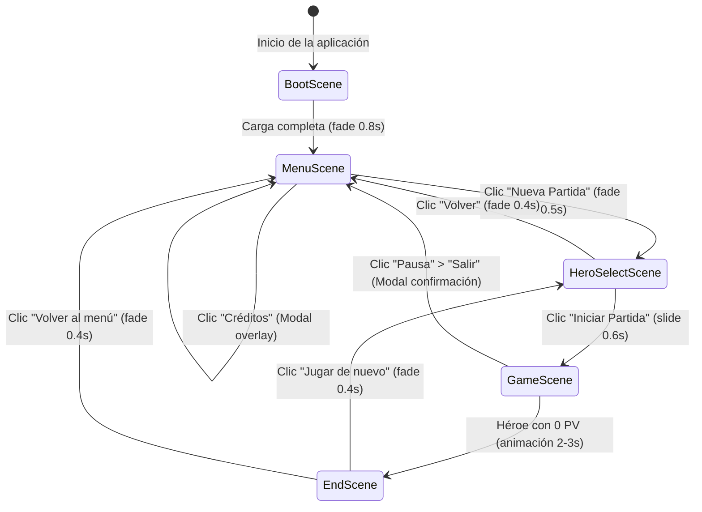

# Documento de Diseño UI/UX
## Crossover Cards — Juego de Cartas Estratégico por Turnos

| Campo         | Valor                                                        |
|---------------|--------------------------------------------------------------|
| Titulo        | Diseño UI/UX — Crossover Cards                               |
| Version       | 1.0.0                                                        |
| Fecha         | 2026-05-23                                                   |
| Estado        | Aprobado                                                     |
| Autores       | Equipo del proyecto (2 personas)                             |
| Fase          | Diseño (Cascada, Día 3-4)                                    |
| Revision      | Generado con asistencia de Google Antigravity (Claude Sonnet)|

---

## Tabla de Contenidos

1. Introducción
2. Sistema visual base
   - 2.1 Paleta de colores
   - 2.2 Tipografía
   - 2.3 Iconografía
   - 2.4 Espaciado y rejilla
3. Wireframes de las 5 pantallas
   - 3.1 BootScene
   - 3.2 MenuScene
   - 3.3 HeroSelectScene
   - 3.4 GameScene
   - 3.5 EndScene
4. Componentes UI reutilizables
5. Diseño detallado de la carta
6. Estados interactivos
7. Animaciones clave
8. Easter egg integrado
9. Especificación de assets necesarios
10. Accesibilidad
11. Diagrama de flujo de pantallas
12. Notas para el Phaser-Dev-Agent
13. Decisiones marcadas [PENDIENTE DE VALIDACIÓN]

---

## 1. Introducción

### 1.1 Propósito del Documento

Este documento define el diseño visual completo del juego Crossover Cards, incluyendo el sistema visual base, wireframes de las 5 pantallas, componentes UI reutilizables, estados interactivos, animaciones, especificación de assets y notas de implementación para el Phaser-Dev-Agent. Es el entregable de diseño que cierra la fase de Diseño (cascada, días 3-4) y habilita la fase de Implementación.

### 1.2 Principios Visuales

| Principio      | Descripción | Aplicación concreta |
|----------------|-------------|---------------------|
| Nostalgia      | La estética evoca los cartoons de CN/Nick de los 2000-2010. El reloj de bolsillo victoriano es el símbolo central. | Paleta cálida con fondos oscuros, tipografía Bangers, reloj analógico con manecillas animadas. |
| Claridad       | Cada elemento UI debe comunicar su estado sin ambigüedad. | Indicadores numéricos superpuestos al reloj, glow de color para acciones válidas/inválidas. |
| Accesibilidad  | Contraste WCAG AA mínimo. Indicadores no solo por color. | Texto mínimo 12px, iconos + texto en botones, partículas además de glow para estados. |
| Jerarquía      | El tablero de juego ocupa el 70% de la pantalla; el HUD es compacto y periférico. | Layout 1280x720 con zonas bien delimitadas (ver sección 2.4). |

### 1.3 Referencias

| Documento                  | Ubicación                    |
|----------------------------|------------------------------|
| PRD v1.1.0                 | `docs/01-prd.md`             |
| Arquitectura Técnica v1.0  | `docs/02-architecture.md`    |
| Catálogo de Cartas v1.0    | `docs/04-card-catalog.md`    |
| Skill Phaser Patterns      | `.agent/skills/phaser-patterns/SKILL.md` |

---

## 2. Sistema Visual Base

### 2.1 Paleta de Colores

#### Colores primarios

| Nombre semántico  | Hex       | Uso recomendado                                | Ejemplo de aplicación               |
|-------------------|-----------|------------------------------------------------|--------------------------------------|
| `bg-deep`         | `#0D0B1E` | Fondo principal de todas las escenas           | Color de fondo del canvas de Phaser  |
| `bg-card`         | `#1A1730` | Fondo de paneles HUD, áreas de zona            | Panel lateral derecho, slots vacíos  |
| `bg-surface`      | `#252240` | Fondo elevado: tooltips, modales, cartas       | Tooltip flotante, modal de confirmación |
| `text-primary`    | `#F0EAD6` | Texto principal sobre fondo oscuro             | Nombres de cartas, valores ATQ/VID   |
| `text-secondary`  | `#9B96B0` | Texto secundario, etiquetas, captions          | Tipo de carta, texto de HUD menor    |
| `accent-gold`     | `#F5C842` | Borde Legendaria, reloj cargado, énfasis       | Marco de carta Legendaria, manecillas del reloj a 10/10 |
| `accent-teal`     | `#3ECFCF` | Turno jugador, slots válidos, selección activa | Glow de slot válido, indicador turno |

#### Colores por arquetipo

| Arquetipo        | Nombre         | Hex       | Uso                                         |
|------------------|----------------|-----------|---------------------------------------------|
| Cartoon Clásico  | `arch-cartoon` | `#FF6B35` | Banda lateral izquierda de la carta, borde de zona |
| Aventura Mágica  | `arch-magic`   | `#7B4FDB` | Banda lateral izquierda de la carta         |
| Anime Combate    | `arch-anime`   | `#E83E3E` | Banda lateral izquierda de la carta         |
| Sobrenatural     | `arch-super`   | `#39D98A` | Banda lateral izquierda de la carta         |
| Neutral          | `arch-neutral` | `#8C9099` | Banda lateral izquierda de la carta         |

#### Colores por rareza (borde de carta)

| Rareza     | Nombre          | Hex       |
|------------|-----------------|-----------|
| Común      | `rarity-common` | `#8C9099` |
| Rara       | `rarity-rare`   | `#4A9FDB` |
| Épica      | `rarity-epic`   | `#9B5DE5` |
| Legendaria | `rarity-legend` | `#F5C842` |

#### Colores de feedback

| Nombre            | Hex       | Uso                                                   |
|-------------------|-----------|-------------------------------------------------------|
| `feedback-ok`     | `#4CAF6E` | Slot válido para soltar carta, misión completada      |
| `feedback-damage` | `#FF3B3B` | Flash de daño, HealthCounter <30%, slot inválido      |
| `feedback-warn`   | `#F5A623` | HealthCounter 30-60%, Momentum activo                 |

---

### 2.2 Tipografía

#### Familias seleccionadas

**Familia Display: "Bangers"** (Google Fonts — OFL, libre de uso)

Justificación: tipografía de título de cartoon por excelencia. Apta para grandes titulares y nombres de personajes. Alta personalidad visual que refuerza la estética nostálgica sin sacrificar legibilidad a ≥18px. Se carga desde Google Fonts en `BootScene`.

**Familia Cuerpo: "Nunito"** (Google Fonts — OFL, libre de uso)

Justificación: sans-serif redondeada con excelente legibilidad a tamaños pequeños (12px en texto de habilidades de carta). Sus terminaciones redondeadas armonizan con la estética cartoon. Disponible en pesos 400, 600 y 700.

#### Escala tipográfica

| Nivel    | Familia  | Tamaño | Peso | Uso principal                                    |
|----------|----------|--------|------|--------------------------------------------------|
| Display  | Bangers  | 64px   | 400  | Logo del juego en MenuScene                      |
| H1       | Bangers  | 40px   | 400  | Títulos de pantalla (HeroSelectScene, EndScene)  |
| H2       | Bangers  | 28px   | 400  | Nombre de carta en anverso, nombre de héroe      |
| Body     | Nunito   | 16px   | 400  | Log de acciones, texto de habilidades en tooltip |
| Body SB  | Nunito   | 16px   | 600  | Valores ATQ/VID en tablero, contador de Nostalgia|
| Caption  | Nunito   | 12px   | 400  | Texto de habilidad en anverso de carta           |
| Caption B| Nunito   | 12px   | 700  | Tipo de carta ("Personaje / Hechizo / Objeto")   |

---

### 2.3 Iconografía

> **Nota**: las URLs proporcionadas son páginas base de catálogo verificadas.
> Los enlaces a assets concretos deben buscarse manualmente usando los
> términos sugeridos entre paréntesis. Esta lista se generó tras detectar
> y corregir URLs alucinadas por el LLM (ver Interacción #013 en ai-log.md).

Estilo seleccionado: **dual-tone** (contorno blanco con relleno de color de acento). Coherente con la estética cartoon y legible sobre fondos oscuros.

Fuentes principales:
- **Game-icons.net** (CC BY 3.0, atribución requerida en créditos): iconos de reloj, espada, corazón, escudo, calavera.
- **Kenney Game Icons** (CC0, sin atribución): iconos de mazo, mano, carta, configuración, flecha de fin de turno.

| Icono             | Nombre interno    | Fuente sugerida   | URL base verificada (término de búsqueda)                              |
|-------------------|-------------------|-------------------|------------------------------------------------------------------------|
| Nostalgia (reloj) | `icon-nostalgia`  | Game-icons.net    | https://game-icons.net/tags/tool.html (buscar "clock" o "watch")      |
| Momentum          | `icon-momentum`   | Game-icons.net    | https://game-icons.net/tags/symbol.html (buscar "lightning" o "bolt")  |
| Ataque (espada)   | `icon-attack`     | Game-icons.net    | https://game-icons.net/tags/weapon.html (buscar "sword" o "blade")    |
| Vida (corazón)    | `icon-health`     | Game-icons.net    | https://game-icons.net/tags/body.html (buscar "heart" o "health")     |
| Mazo              | `icon-deck`       | Kenney Game Icons | https://kenney.nl/assets/game-icons (buscar "cards" o "deck")         |
| Mano              | `icon-hand`       | Kenney Game Icons | https://kenney.nl/assets/game-icons (buscar "hand")                   |
| Zona / Entorno    | `icon-zone`       | Game-icons.net    | https://game-icons.net/tags/symbol.html (buscar "zone" o "crystal")   |
| Misión (bandera)  | `icon-quest`      | Game-icons.net    | https://game-icons.net/tags/symbol.html (buscar "flag" o "quest")     |
| Crossover (portal)| `icon-crossover`  | Game-icons.net    | https://game-icons.net/tags/symbol.html (buscar "portal" o "vortex")  |
| Fin de turno      | `icon-end-turn`   | Kenney Game Icons | https://kenney.nl/assets/game-icons (buscar "arrow" o "next")         |
| Configuración     | `icon-settings`   | Kenney Game Icons | https://kenney.nl/assets/game-icons (buscar "settings" o "gear")      |
| Escudo (Divine)   | `icon-shield`     | Game-icons.net    | https://game-icons.net/tags/body.html (buscar "shield" o "armor")     |

Tamaño base de iconos en HUD: **24×24px**. En carta (ATQ/VID): **16×16px**.

---

### 2.4 Espaciado y Rejilla

#### Sistema de espaciado

Unidad base: **4px**. Todos los márgenes, paddings y gaps son múltiplos de 4.

| Token        | Valor | Uso típico                                      |
|--------------|-------|-------------------------------------------------|
| `space-xs`   | 4px   | Padding interno de iconos, separación caption   |
| `space-sm`   | 8px   | Padding de valores numéricos en carta, gaps HUD |
| `space-md`   | 16px  | Padding de panel HUD, separación entre slots    |
| `space-lg`   | 24px  | Margen entre zonas del tablero                  |
| `space-xl`   | 32px  | Margen lateral del layout, separación de héroe  |

#### Rejilla base 1280×720

```
+------------------------------------------------------------------+
| 1280px                                                           |
|  +--------+  +----------------------------------------+  +-----+|
|  | HUD    |  |          TABLERO (900px)               |  | HUD ||
|  | IZQ    |  |                                        |  | DER ||
|  | 120px  |  |  Zona oponente (superior)              |  | 160px||
|  |        |  |  +-+  +-+  +-+  +-+  +-+  +-+  +-+   |  |     ||
|  | Log    |  |  |1|  |2|  |3|  |4|  |5|  |6|  |7|   |  | Rel.||
|  | accio- |  |  +-+  +-+  +-+  +-+  +-+  +-+  +-+   |  | Nos ||
|  | nes    |  |  [zona izq] [zona ctr] [zona der] [sl] |  |     ||
|  |        |  |  =========== CENTRO ===============    |  | Mom ||
|  | Pausa  |  |  [zona izq] [zona ctr] [zona der] [sl] |  | Bar ||
|  |        |  |  +-+  +-+  +-+  +-+  +-+  +-+  +-+   |  |     ||
|  |        |  |  |1|  |2|  |3|  |4|  |5|  |6|  |7|   |  | Maz ||
|  |        |  |  +-+  +-+  +-+  +-+  +-+  +-+  +-+   |  |     ||
|  |        |  |  Zona jugador (inferior)               |  | Fin ||
|  |        |  |  [MANO DEL JUGADOR — max 10 cartas]    |  | Turn||
|  +--------+  +----------------------------------------+  +-----+|
| 720px                                                            |
+------------------------------------------------------------------+
```

Distribución horizontal:
- HUD izquierdo: 120px fijo
- Tablero central: 900px (zona principal)
- HUD derecho: 160px fijo
- Separación entre HUD y tablero: 16px (space-md) × 2

Distribución vertical del tablero (900×720):
- Retrato + vida oponente: 64px
- Mano oculta oponente (contador): 32px
- Tablero oponente (2 filas de slots): 160px
- Línea divisoria central + zonas etiquetadas: 40px
- Tablero jugador (2 filas de slots): 160px
- Retrato + vida jugador: 64px
- Mano del jugador (abanico): 200px

---

## 3. Wireframes de las 5 Pantallas

### 3.1 BootScene

**Propósito**: carga inicial de todos los assets del juego. Oculta la latencia de carga mostrando identidad de marca.

#### Wireframe ASCII

```
+--------------------------------------------------+
|                                                  |
|                                                  |
|         ____  ____   ___  ____ ____ _____        |
|        / ___|/ ___| / _ \|  _ \___ \  ___|       |
|       | |   |___ \| | | | | | |__) |___ \       |
|       | |___ ___) | |_| | |_| / __/ ___) |      |
|        \____|____/ \___/|____/_____|____/        |
|               C A R D S                         |
|                                                  |
|         [reloj de bolsillo animado 128px]        |
|                  (icono central)                 |
|                                                  |
|     Cargando assets...                           |
|     +========================================+  |
|     |####################                    |  |
|     +========================================+  |
|                   42%                           |
|                                                  |
|  v1.0.0                          © 2026 Equipo  |
+--------------------------------------------------+
  1280x720
```

#### Elementos UI presentes

- Logo "Crossover Cards" con tipografía Bangers 64px, color `accent-gold`.
- Icono central del reloj de bolsillo (`nostalgia-clock-idle.png`), 128×128px, rotación lenta de manecillas como animación de espera.
- Texto "Cargando assets..." en Nunito 16px, color `text-secondary`.
- Barra de progreso: fondo `bg-card`, relleno `accent-teal`, bordes redondeados 4px. Altura 12px, ancho 480px centrado.
- Porcentaje numérico debajo de la barra, Nunito 16px Bold.
- Versión v1.0.0 en esquina inferior izquierda, Caption 12px.
- Copyright en esquina inferior derecha, Caption 12px.

#### Estados posibles

| Estado     | Descripción                                               |
|------------|-----------------------------------------------------------|
| Cargando   | Barra de progreso avanza de 0 a 100%, porcentaje visible  |
| Completado | Barra llena, breve pausa 0.5s, fade-out a negro, fade-in MenuScene |
| Error      | [FUERA DE SCOPE MVP] mensaje de error de red              |

#### Inputs aceptados

Ninguno. La pantalla es completamente pasiva durante la carga.

#### Easter egg de BootScene

Si el usuario hace clic 3 veces sobre el reloj de bolsillo durante la carga, el reloj hace un giro completo en sentido contrario y emite un sonido de "rebobinado de VHS" (sin interrumpir la carga). No tiene efecto en el juego; es un guiño menor al jugador curioso.

#### Transición

BootScene → MenuScene (automática al completar la carga, fade 0.8s).

---

### 3.2 MenuScene

**Propósito**: menú principal con acceso a la partida y opciones secundarias.

#### Wireframe ASCII

```
+--------------------------------------------------+
|  [particulas flotantes: estrellas doradas 2-4px] |
|  [fondo: bg-deep con gradiente radial sutil]      |
|                                                  |
|                                                  |
|         ____  ____   ___  ____ ____ _____        |
|        / ___|/ ___| / _ \|  _ \___ \  ___|       |
|       | |   |___ \| | | | | | |__) |___ \       |
|       | |___ ___) | |_| | |_| / __/ ___) |      |
|        \____|____/ \___/|____/_____|____/        |
|               C A R D S                         |
|                                                  |
|          +-----------------------------+         |
|          |       NUEVA PARTIDA        |         |
|          +-----------------------------+         |
|                                                  |
|          +-----------------------------+         |
|          |        CÓMO JUGAR          |         |
|          +-----------------------------+         |
|                                                  |
|          +-----------------------------+         |
|          |         CRÉDITOS           |         |
|          +-----------------------------+         |
|                                                  |
|  v1.0.0                                         |
+--------------------------------------------------+
```

#### Elementos UI presentes

- Logo centrado, Bangers 64px, `accent-gold`, sombra de texto `rgba(245,200,66,0.4)` 0 0 20px.
- Fondo: `bg-deep` con gradiente radial desde `#1A1730` en centro a `#0D0B1E` en bordes.
- Partículas: 30-40 puntos dorados de 2-4px flotando lentamente (velocidad 10-20px/s, rebote suave en bordes). Implementadas con `Phaser.GameObjects.Particles`.
- 3 botones primarios apilados verticalmente, separación 16px:
  - **Nueva Partida**: 320×56px, fondo `accent-teal`, texto Bangers 28px `bg-deep`.
  - **Cómo Jugar**: 320×56px, fondo `bg-surface`, borde 2px `accent-teal`, texto Nunito 16px SB `text-primary`.
  - **Créditos**: 320×56px, misma estética que Cómo Jugar.
- Versión v1.0.0 esquina inferior izquierda, Nunito Caption 12px `text-secondary`.

#### Estados posibles

| Estado        | Descripción                                                  |
|---------------|--------------------------------------------------------------|
| Idle          | Partículas animadas, botones en estado default               |
| Hover botón   | Botón escala a 105%, glow `accent-teal` (ver sección 4)     |
| Transición    | Fade-out 0.5s al pulsar Nueva Partida                        |

#### Inputs aceptados

- Clic en "Nueva Partida": → HeroSelectScene.
- Clic en "Cómo Jugar": abre Modal de instrucciones (overlay sobre MenuScene).
- Clic en "Créditos": abre Modal de créditos.

#### Transición

MenuScene → HeroSelectScene (al pulsar Nueva Partida, fade 0.5s).

---

### 3.3 HeroSelectScene

**Propósito**: el jugador elige entre El Lich y Axel Blaze antes de comenzar la partida.

#### Wireframe ASCII

```
+--------------------------------------------------+
|  [< VOLVER]          ELIGE TU HÉROE              |
|  ________________   ________________             |
|  |              |   |              |             |
|  |  [RETRATO    |   |  [RETRATO    |             |
|  |   EL LICH]   |   |  AXEL BLAZE] |             |
|  |   240x320px  |   |   240x320px  |             |
|  |______________|   |______________|             |
|  EL LICH            AXEL BLAZE                   |
|  30 PV              30 PV                        |
|  Hechizo Ancestral  Tornado de Fuego             |
|  Coste: 2 Nos.      Coste: 2 Nos.                |
|  Control / Desgaste Agresivo / Buff              |
|  [Estilo: oscuro]   [Estilo: fuego]              |
|                                                  |
|  +-- MAZO PREVIEW (10 nombres de carta) -------+ |
|  | 1. Pops (2)  2. Darwin (2)  3. Chowder (3)  | |
|  | 4. Patricio (3)  5. Rigby (2)  6. Jake (4)  | |
|  | 7. Superbocata (4)  8. Cangreburger (2)      | |
|  | 9. El Poder (3)  10. Espada Demonio (5)      | |
|  +----------------------------------------------+ |
|                                                  |
|           [ INICIAR PARTIDA ]                    |
+--------------------------------------------------+
```

#### Elementos UI presentes

- Título "Elige tu Héroe", Bangers H1 40px, centrado.
- Botón "< Volver" esquina superior izquierda, Nunito 16px.
- Dos paneles de héroe, 280×480px cada uno, separados 40px. Cada panel:
  - Retrato del héroe: 240×320px, marco coloreado según arquetipo (morado-verde para El Lich, rojo-naranja para Axel Blaze). Al seleccionar, marco con glow `accent-teal` pulsante.
  - Nombre del héroe: Bangers H2 28px.
  - Stats: vida (icono + número), habilidad (nombre + coste), estilo de juego. Nunito Body 16px.
  - Etiqueta de estilo visual.
- Panel de vista previa del mazo: lista de 10 cartas con nombre y coste entre paréntesis. Nunito Body 14px. Fondo `bg-card`, padding 16px, bordes redondeados 8px. Solo visible para el héroe seleccionado actualmente (el otro panel está semitransparente al 60%).
- Botón "Iniciar Partida": 320×56px, fondo `accent-gold`, texto Bangers 28px `bg-deep`. Deshabilitado (50% opacidad) si no hay héroe seleccionado.

#### Estados posibles

| Estado              | Descripción                                                    |
|---------------------|----------------------------------------------------------------|
| Sin selección       | Ambos paneles al 100% opacidad, botón Iniciar deshabilitado   |
| Héroe seleccionado  | Panel seleccionado con glow teal, rival al 60% opacidad, botón activo |
| Hover panel         | Escala leve 102%, sombra más pronunciada                       |

#### Inputs aceptados

- Clic en panel de héroe: selecciona ese héroe.
- Clic en "< Volver": → MenuScene.
- Clic en "Iniciar Partida" (activo): → GameScene.

#### Transición

HeroSelectScene → GameScene (slide 0.6s hacia la izquierda) | HeroSelectScene → MenuScene (fade 0.4s).

---

### 3.4 GameScene

**Propósito**: pantalla principal de la partida en curso.

#### Wireframe ASCII (1280×720)

```
+------+------------------------------------------+--------+
| HUD  | [RETRATO RIVAL 64px] [VID] [MANO: N cartas]| HUD    |
| IZQ  +------------------------------------------+ DER    |
|120px |  TABLERO OPONENTE (7 slots max)           |160px   |
|      |  +----+ +----+ +----+ +----+ +----+...[7] |        |
|[LOG  |  | P1 | | P2 | | P3 | |    | |    |       |[RELOJ  |
|ACCI- |  +----+ +----+ +----+ +----+ +----+       |NOSTAL. |
|ONES] |  [ZONA IZQ: ENV] [ZONA CTR:ENV] [ZONA DER] |128px]  |
|      |  =========================================|        |
|      |  [ZONA IZQ: ENV] [ZONA CTR:ENV] [ZONA DER] |[X/10]  |
|[BTN  |  +----+ +----+ +----+ +----+ +----+...[7] |        |
|PAUSA]|  | P1 | | P2 | |    | |    | |    |       |[MOMENT.|
|      |  +----+ +----+ +----+ +----+ +----+       |BAR]    |
|      |  TABLERO JUGADOR (7 slots max)             |        |
|      | [RETRATO JUG 64px] [VID] [BTN HABILIDAD]   |[MAZO   |
|      +------------------------------------------+ N ctas] |
|      | [MANO JUGADOR: max 10 cartas en abanico]  |        |
|      | /CARTA\ /CARTA\ /CARTA\ /CARTA\ ...       |[BTN    |
|      |                                           |FIN TUR]|
+------+------------------------------------------+--------+
```

#### Zona del oponente (parte superior del tablero)

- **Retrato de héroe enemigo**: HeroPortrait 64×64px, esquina superior izquierda del tablero, marco según arquetipo rival.
- **Vida del rival**: HealthCounter junto al retrato, número grande Bangers 28px + icono corazón 16px.
- **Mano oculta**: texto "Mano: N" con icono de cartas boca abajo. Nunito 14px. Máximo 10.
- **Slots del tablero enemigo**: 7 slots horizontales de 80×100px cada uno. Slots ocupados muestran la carta boca arriba (pero el jugador no puede interactuar). Slots vacíos con contorno punteado `bg-card`.

#### Centro del tablero (zonas dinámicas)

- **3 zonas etiquetadas**: Izquierda, Centro, Derecha. Cada zona muestra:
  - Icono del entorno activo (24×24px) + nombre corto (Nunito Caption 12px).
  - Color de fondo tenue: `rgba(entorno-color, 0.15)` sobre el fondo del tablero.
  - Línea separadora horizontal de 2px, `bg-surface`, que divide tablero oponente/jugador.
- **Slot libre** (fuera de zonas): posicionado a la derecha de las 3 zonas. Borde punteado 2px `text-secondary` a 40% opacidad, interior `bg-deep`. Indica tácticamente al jugador que existe.
- Etiquetas de zona en línea divisoria central: Nunito Caption 12px, color del entorno activo.

#### Zona del jugador (parte inferior del tablero)

- **Retrato de héroe propio**: HeroPortrait 64×64px, marco según arquetipo propio.
- **Vida propia**: HealthCounter, mismo formato que rival.
- **Botón de habilidad de héroe**: 80×40px, fondo `bg-surface`, borde `accent-gold`, icono de habilidad 24px. Deshabilitado si: Nostalgia insuficiente, ya usada este turno, turno del rival.
- **Slots del tablero propio**: 7 slots de 80×100px. Durante la fase principal, al arrastrar carta sobre ellos se activa el glow de valid/invalid.

#### HUD lateral izquierdo (120px)

- **Log de acciones** (ActionLog): lista scrollable de las últimas 5 acciones del turno, Nunito Caption 12px, `text-secondary`. Fondo `bg-card` con padding 8px. Altura ~400px.
- **Botón Menú/Pausa**: 104×40px en la parte inferior del panel izquierdo. Ícono de pausa + texto "PAUSA", Nunito 14px.

#### HUD lateral derecho (160px)

- **NostalgiaClockUI**: reloj de bolsillo analógico, 128×128px centrado en el HUD derecho. Manecillas animadas. Indicador digital "X/10" superpuesto en la zona inferior del reloj, Nunito 16px Bold `text-primary`.
- **MomentumBar**: barra vertical de 16×80px, solo visible cuando el jugador está en estado Momentum (PV ≤15). Relleno `feedback-warn`. Número de puntos acumulados encima (Nunito 14px Bold).
- **DeckCounter**: icono de mazo 24px + número de cartas restantes, Nunito 14px, `text-primary`. Centrado en HUD derecho.
- **Botón Crossover**: 144×40px, fondo `arch-magic` (morado), icono `icon-crossover` + texto "CROSSOVER" Bangers 16px. Deshabilitado (50% opacidad) tras uso.
- **EndTurnButton**: 144×56px, fondo `accent-teal`, texto Bangers 28px "FIN TURNO". Atenuado durante turno rival.
- **QuestTracker**: miniatura compacta 144×48px en el HUD derecho, entre MomentumBar y DeckCounter. Muestra nombre corto de la misión activa (Nunito 12px) + barra de progreso estrecha (4px de alto). Al hacer hover: popup ampliado de 280×160px con descripción completa, progreso actual/objetivo y condición de recompensa. Sin misión activa: invisible.

#### Tooltip flotante

Aparece al hacer hover ≥300ms sobre carta en mano o Personaje en tablero. Ver especificación completa en sección 4.

#### Elementos adicionales de GameScene

- **Indicador de fase activa**: banner compacto 200×32px centrado en la parte superior del tablero. Texto "FASE PRINCIPAL" / "FASE COMBATE" / "TURNO RIVAL" en Bangers 18px. Fondo `bg-surface` con borde `accent-teal` (turno propio) o `feedback-damage` (turno rival).
- **Contador de turno**: "Turno 3" en Nunito Caption 12px junto al indicador de fase.
- **EasterEggTV**: televisor retro 48×48px en la esquina inferior izquierda del fondo del tablero (dentro del área del tablero, no del HUD). Parpadeo de estática cada 4-8 segundos. No tiene tooltip.

#### Inputs aceptados

- Clic en carta propia en mano: eleva y muestra confirmación.
- Arrastrar carta al tablero: activar drag, glow de slots válidos/inválidos.
- Clic en Personaje propia no exhausta (fase combate): modo selección de atacante.
- Clic en objetivo enemigo (tras selección de atacante): confirmar ataque.
- Clic en botón Habilidad de héroe: selección de objetivo si procede.
- Clic en EndTurnButton: → Fase siguiente / turno rival.
- Clic en QuestTracker: hover expande popup, clic fuera lo cierra.
- Clic en EasterEggTV: incrementa contador oculto (ver sección 8).

#### Transición

GameScene → EndScene (automática al terminar partida, animación 2s).

---

### 3.5 EndScene

**Propósito**: pantalla de resultado: victoria, derrota o empate con estadísticas rápidas.

#### Wireframe ASCII — Victoria

```
+--------------------------------------------------+
|  [confetti animado, particulas doradas]           |
|                                                  |
|           +---------------------------+          |
|           |      VICTORIA!            |          |
|           |   (banner, accent-gold)   |          |
|           +---------------------------+          |
|                                                  |
|  Turnos jugados: 12      Daño infligido: 47      |
|  Sinergias activadas: 3  Misiones completadas: 1 |
|                                                  |
|  +---------------------+  +------------------+  |
|  |   JUGAR DE NUEVO    |  | VOLVER AL MENÚ   |  |
|  +---------------------+  +------------------+  |
|                                                  |
+--------------------------------------------------+
```

#### Wireframe ASCII — Derrota

```
+--------------------------------------------------+
|  [overlay oscuro semitransparente, sombras]       |
|  [vignette oscuro en bordes]                     |
|                                                  |
|           +---------------------------+          |
|           |       DERROTA            |          |
|           |  (banner, feedback-damage)|          |
|           +---------------------------+          |
|                                                  |
|  Turnos jugados: 8       Daño infligido: 21      |
|  Sinergias activadas: 1  Misiones completadas: 0 |
|                                                  |
|  +---------------------+  +------------------+  |
|  |   JUGAR DE NUEVO    |  | VOLVER AL MENÚ   |  |
|  +---------------------+  +------------------+  |
|                                                  |
+--------------------------------------------------+
```

#### Elementos UI presentes

- Banner central de resultado: 480×100px, Bangers Display 64px. Color `accent-gold` (Victoria), `feedback-damage` (Derrota), `accent-teal` (Empate).
- Resumen estadístico: 4 métricas en 2 columnas. Nunito Body 16px, labels en `text-secondary`, valores en `text-primary` Bold.
- Dos botones: "Jugar de nuevo" (fondo `accent-teal`) y "Volver al menú" (fondo `bg-surface`, borde `text-secondary`). 240×56px cada uno.
- Animación de victoria: `Phaser.GameObjects.Particles` con partículas doradas y confeti de 8 colores. Duración: 3s de explosión + loop suave.
- Animación de derrota: overlay `rgba(0,0,0,0.6)` que aparece en fade-in 1s. Vignette oscuro en bordes. Sin partículas.

#### Inputs aceptados

- Clic en "Jugar de nuevo": → HeroSelectScene (fade 0.4s).
- Clic en "Volver al menú": → MenuScene (fade 0.4s).

---

## 4. Componentes UI Reutilizables

### 4.1 CardSprite

**Propósito**: representación visual completa de una carta, usada en la mano del jugador, en el tablero y en el tooltip.

**Versiones**:
- **Mano**: 80×112px, en abanico con rotación entre -10° y +10° según posición. En hover: rotación 0°, escala 115%, eleva 20px, sombra `rgba(0,0,0,0.6)` 0 8px 24px.
- **Tablero (Personaje activa)**: 72×96px, sin inclinación, orientación vertical.
- **Reverso (mano oponente)**: 80×112px, imagen `card-back.png`, sin información visible.

**Estados**:

| Estado     | Visual                                                                          |
|------------|---------------------------------------------------------------------------------|
| Default    | Carta con rotación de abanico, sombra suave 0 2px 8px                          |
| Hover      | Rotación 0°, escala 115%, eleva 20px, z-index máximo                            |
| Seleccionada | Borde `accent-teal` 3px glow pulsante (animación 1s ease-in-out loop)         |
| Arrastrada | Opacidad 95%, sombra 0 12px 32px, cursor grab                                  |
| Disabled   | Opacidad 40%, sin interacción (turno rival, Nostalgia insuficiente)             |
| Legendaria | Borde `rarity-legend` con partículas doradas flotantes al jugarse              |

**Animaciones**: hover (0.15s ease), elevación en abanico (0.1s), invocación al tablero (0.4s, ver sección 7).

---

### 4.2 NostalgiaClockUI

**Propósito**: elemento visual central del HUD derecho. Representa los puntos de Nostalgia disponibles de forma analógica (manecillas) y digital (X/10).

**Diseño híbrido** (según decisión aprobada):
- Reloj de bolsillo analógico, 128×128px. Esfera oscura `bg-card`, borde dorado `accent-gold` 3px.
- Manecilla de minutos: representa Nostalgia actual (0-10). Avanza en sentido horario.
- Manecilla de horas: estática, señala el máximo de Nostalgia del turno.
- Indicador digital "X/10" en Nunito 16px Bold `text-primary`, centrado debajo del reloj o superpuesto en la zona de las 6 en punto.
- Cadena victoriana decorativa (`nostalgia-clock-chain.png`) sobre el reloj.

**Estados**:

| Estado           | Visual                                                                        |
|------------------|-------------------------------------------------------------------------------|
| Cargado (10/10)  | Esfera con brillo dorado sutil, manecilla apunta a las 12                     |
| Parcial (X/10)   | Manecilla en posición proporcional, sin brillo                                |
| Vacío (0/10)     | Manecilla en posición 0, esfera oscurecida `rgba(0,0,0,0.3)` overlay         |
| Ganando Nostalgia| Animación de avance de manecilla 0.5s ease-out                               |
| Gastando         | Animación de retroceso en sentido contrario 0.3s, destello `accent-teal`      |

**Tamaño**: 128×128px. Implementación: `Phaser.GameObjects.Container` con `Image` (esfera) + `Image` (manecilla) rotada con `setAngle()` + `Text` (digital).

---

### 4.3 MomentumBar

**Propósito**: indicador de puntos de Momentum acumulados. Solo visible cuando el jugador está en estado Momentum (PV ≤15).

**Diseño**: barra vertical de 16×80px, con segmentos de 8px de alto por cada punto (máximo 10 segmentos). Color `feedback-warn` (#F5A623). Número de puntos acumulados encima en Nunito 14px Bold. Icono `icon-momentum` 16px sobre el número.

**Estados**:

| Estado    | Visual                                                             |
|-----------|--------------------------------------------------------------------|
| Inactivo  | Oculto (alpha 0, no ocupa espacio)                                 |
| Activado  | Aparece con fade-in 0.6s, relleno proporcional a los puntos        |
| Pulsante  | Animación de pulso suave (escala 1.0→1.05→1.0, 1.5s loop) cuando hay ≥5 puntos |
| Al gastar | Barra se vacía en segmentos con animación 0.3s por segmento gastado |

---

### 4.4 HeroPortrait

**Propósito**: retrato visual del héroe (propio y rival) con marco temático y indicadores de estado.

**Tamaño**: 64×64px en GameScene; 240×320px en HeroSelectScene.

**Marcos según héroe**:
- El Lich: borde 3px `arch-magic` (#7B4FDB) con esquinas ornamentadas en `arch-super` (#39D98A). Efecto de neblina verde muy sutil como background-filter.
- Axel Blaze: borde 3px `arch-anime` (#E83E3E) con destellos naranjas `#FF6B35` en las esquinas.

**Estados**:

| Estado           | Visual                                                              |
|------------------|---------------------------------------------------------------------|
| Default          | Marco estático, retrato centrado                                    |
| Turno activo     | Marco con glow pulsante `accent-teal` 0 0 12px                     |
| Bajo vida (<30%) | Marco parpadea `feedback-damage` 1s loop                           |
| Habilidad usada  | Icono de habilidad sobre el retrato con animación de fade-out 1s   |

---

### 4.5 HealthCounter

**Propósito**: muestra los puntos de vida del héroe con cambio de color según porcentaje.

**Diseño**: icono corazón `icon-health` 16px + número grande Bangers 28px. Sin barra de vida (claridad > decoración).

**Cambio de color según PV**:
- PV >60% (>18 de 30): color `feedback-ok` (#4CAF6E).
- PV 30-60% (9-18 de 30): color `feedback-warn` (#F5A623).
- PV <30% (<9 de 30): color `feedback-damage` (#FF3B3B) + animación de pulso suave.

**Animación al recibir daño**: el número cae 8px y rebota en 0.3s. Color destella `feedback-damage` 0.5s.

---

### 4.6 DeckCounter

**Propósito**: muestra el número de cartas restantes en el mazo.

**Diseño**: icono de mazo `icon-deck` 24px + número Nunito 14px Bold. En HUD derecho, bajo el QuestTracker. Tamaño total 144×32px.

**Estados**: color `text-primary` con ≥5 cartas; `feedback-warn` con 1-4 cartas; `feedback-damage` con 0 cartas (mazo agotado, fatiga activa).

---

### 4.7 EndTurnButton

**Propósito**: botón de fin de turno. Es el elemento más prominente del HUD durante el turno del jugador.

**Diseño**: 144×56px, fondo `accent-teal`, texto Bangers 28px "FIN TURNO" color `bg-deep`, esquinas redondeadas 8px.

**Estados**:

| Estado          | Visual                                                              |
|-----------------|---------------------------------------------------------------------|
| Turno jugador   | Fondo `accent-teal`, glow sutil `rgba(62,207,207,0.4)` externo     |
| Hover           | Fondo `#5DDFDF` (10% más claro), escala 103%                       |
| Pressed         | Fondo `#2EAAAA`, escala 98%, sombra interna                        |
| Turno rival     | Fondo `bg-surface`, texto `text-secondary`, no interactivo         |

---

### 4.8 Tooltip

**Propósito**: información detallada de una carta o Personaje en tablero, al pasar el cursor ≥300ms.

**Diseño**: panel 280×200px (Personaje) / 280×160px (Hechizo/Objeto). Fondo `bg-surface`, borde 2px del color de rareza de la carta, bordes redondeados 8px. Sombra 0 8px 24px `rgba(0,0,0,0.7)`. Posición: aparece encima de la carta si hay espacio; debajo si está en la parte superior de la pantalla.

**Contenido**:
- Nombre: Bangers H2 28px.
- Tipo + Arquetipo: Nunito Caption 12px Bold `text-secondary`.
- Retrato de la carta: 80×80px.
- Estadísticas (Personaje): ATQ y VID con iconos 16px. Nunito Body SB 16px.
- Coste de Nostalgia: icono reloj 16px + número Nunito 16px Bold.
- Texto de habilidad: Nunito Caption 12px `text-primary`. Máximo 5 líneas.
- Rareza: indicador de color + nombre en Nunito Caption 12px.

**Animación**: fade-in 0.15s. No sigue al cursor (permanece anclado a la carta).

---

### 4.9 Toast

**Propósito**: mensaje breve flotante para notificaciones del sistema de juego (misión completada, cambio de entorno, crossover activado).

**Diseño**: banner horizontal 320×48px centrado en la parte superior del tablero. Fondo según tipo: `feedback-ok` (positivo), `feedback-warn` (neutro), `feedback-damage` (negativo). Texto Nunito 16px Bold `text-primary`. Icono 24px a la izquierda.

**Animación**: slide-down desde fuera de pantalla 0.3s ease-out, permanece 2.5s, slide-up 0.3s ease-in. Varios toasts se apilan verticalmente con separación 8px.

---

### 4.10 Modal

**Propósito**: confirmaciones y pantallas de información (instrucciones, créditos, rendirse).

**Diseño**: overlay `rgba(0,0,0,0.7)` que cubre toda la pantalla. Panel central 480×320px, fondo `bg-surface`, borde 2px `bg-card`, bordes redondeados 12px.

**Estructura interna**: título Bangers H1 40px + contenido variable + botones de acción (primario `accent-teal`, secundario `bg-card`).

**Animación**: overlay fade-in 0.2s, panel scale 0.9→1.0 en 0.2s ease-out. Cierre: inverso.

---

## 5. Diseño Detallado de la Carta

### 5.1 Plantilla del Anverso (Personaje)

```
+--[RELOJ 24px]--+------ 80px ------+
| [COSTE NOS.]   |    [NOMBRE]       |
| (Nos. en num)  | Bangers 14px      |
+----------------+------------------+
|                                   |
|      [RETRATO DEL PERSONAJE]      |
|           56x64px                 |
|                                   |
+--[ATQ  16px]--+---[VID  16px]----+
| [icono] 3     |      2 [icono]   |
+---------------+------------------+
| [BANDA ARQUET. 6px | color arq.] |
+------------------------------------+
| Texto habilidad    Nunito 12px    |
| Máx. 3 líneas      `text-primary` |
+------------------------------------+
| PERSONAJE           [RAREZA DOT]  |
| Nunito 12px Bold    (color rareza)|
+------------------------------------+
```

**Borde externo** (3px): color según rareza (ver paleta §2.1).
**Banda lateral izquierda** (6px ancho, altura total): color según arquetipo.
**Zona de coste** (superior izquierda): círculo de 28px, fondo `bg-deep`, número Nunito 16px Bold + icono reloj 12px.
**Zona retrato**: fondo `bg-card`, imagen centrada y recortada a 56×64px.
**Zona ATQ**: triángulo inferior izquierdo 32×24px, fondo `feedback-damage` tenue, icono `icon-attack` 12px + número Nunito 14px Bold.
**Zona VID**: triángulo inferior derecho 32×24px, fondo `feedback-ok` tenue, icono `icon-health` 12px + número Nunito 14px Bold.
**Zona habilidad**: fondo `bg-surface`, padding 4px, texto Nunito Caption 12px.
**Banda tipo**: fondo `bg-deep`, texto "PERSONAJE" Nunito Caption 12px Bold centrado + punto de rareza (8px, color `rarity-*`).

### 5.2 Plantilla del Anverso (Hechizo / Objeto)

Igual que Personaje salvo:
- Sin zonas ATQ y VID.
- La zona de retrato ocupa el 60% de la carta (más grande).
- Banda tipo muestra "HECHIZO" o "OBJETO".
- En Objetos: indicador de Durabilidad (iconos de estrella) en esquina superior derecha.

### 5.3 Plantilla del Reverso

```
+----------- 80px ----------+
|  [TEXTURA PATTERN bg-card] |
|                            |
|   [LOGO "CC" centrado]     |
|   Bangers 24px accent-gold |
|                            |
|  [BORDE 3px text-secondary]|
+----------------------------+
```

Fondo: pattern de rombos pequeños `bg-card` sobre `bg-deep`. Logo "CC" en `accent-gold`. Borde exterior 3px `text-secondary`.

### 5.4 Versión "Carta en Tablero" (Personaje activa)

```
+---- 72px ----+
| [RETRATO]    |
|   56x56px   |
| [ATQ] | [VID]|
|  3    |   2  |
+--------------+
```

Sin nombre, sin texto de habilidad. Solo retrato + ATQ + VID. Tamaño 72×96px. Borde del color de rareza. Si la Personaje está **exhausta**: overlay semitransparente gris `rgba(150,150,150,0.45)`. Si **lista para atacar**: animación de respiración (escala 1.0→1.03→1.0, 1.8s loop).

---

## 6. Estados Interactivos

| Estado                          | Feedback visual                                                                                   | Indicador no-color                    |
|---------------------------------|---------------------------------------------------------------------------------------------------|---------------------------------------|
| Carta seleccionada en mano      | Elevación 20px, rotación 0°, escala 115%, borde `accent-teal` 2px glow                           | Sombra pronunciada visible            |
| Carta arrastrada hacia tablero  | Opacidad 95%, sombra 0 12px 32px, cursor cambia a `grab`                                         | Cursor diferente al de hover          |
| Slot válido para soltar carta   | Glow `feedback-ok` 0 0 12px, fondo `rgba(76,175,110,0.2)` en el slot                             | Borde punteado verde se torna sólido  |
| Slot inválido                   | Glow `feedback-damage` 0 0 12px, fondo `rgba(255,59,59,0.15)`                                    | Borde punteado rojo se torna sólido   |
| Personaje lista para atacar     | Animación de respiración (escala 1.0↔1.03, 1.8s loop), borde `accent-teal` sutil                 | Pequeña partícula amarilla encima     |
| Personaje exhausta              | Alpha 0.55, overlay gris `rgba(150,150,150,0.45)`, sin interacción                               | Icono de "zzz" muy pequeño en esquina |
| Personaje siendo atacada        | Shake horizontal ±6px en 0.25s (3 oscilaciones), flash overlay `feedback-damage` 0.2s            | Número de daño flotante (+rojo)       |
| Personaje muriendo              | Fade-out alpha 1→0 en 0.5s, partículas de color del arquetipo expandiéndose                      | Efecto de escala 1→0.8 al desvanecerse|
| Objetivo seleccionable (ataque) | Glow `feedback-damage` pulsante en objetivo, resaltado de borde 2px `feedback-damage`            | Borde diferenciado del fondo          |
| Habilidad de héroe disponible   | Icono de habilidad con brillo `accent-gold` sutil                                                 | Etiqueta "Disponible" en Nunito 10px  |

---

## 7. Animaciones Clave

Todas las animaciones son implementables con `Phaser.Tweens` y `Phaser.GameObjects.Particles`. Sin físicas complejas.

| Animación              | Duración | Descripción técnica                                                                                          |
|------------------------|----------|--------------------------------------------------------------------------------------------------------------|
| Robar carta            | 0.4s     | La carta vuela desde la posición del mazo (HUD derecho, DeckCounter) hacia la mano del jugador. Tween de posición con ease `Power2.easeOut`. Al llegar, las demás cartas en mano se redistribuyen en abanico (0.2s). |
| Jugar carta (Personaje)| 0.5s     | La carta seleccionada vuela desde la mano hacia el slot del tablero. Tween de posición + rotación 0° + escala 1.0 (desde 1.15). Al aterrizar, efecto de "impacto" (scale 1.0→1.1→1.0 en 0.2s). Si tiene Battlecry, Toast aparece. |
| Jugar hechizo          | 0.4s     | Carta vuela al centro del tablero, destello del color del efecto, fade-out. Si tiene objetivo, línea de efecto desde la carta al objetivo (0.2s). |
| Atacar                 | 0.6s     | El atacante se desplaza 40% hacia el defensor (0.2s ease-in), impacto (flash `feedback-damage` 0.1s en defensor), retorno a posición (0.2s ease-out). Shake del defensor (0.25s). Números de daño flotan y se desvanecen (0.8s). |
| Cambio de zona/entorno | 0.8s     | Fondo de la zona transiciona entre colores con crossfade (0.4s). Toast "Entorno cambia a [nombre]" aparece. Icono del nuevo entorno entra con scale 0→1 (0.3s). |
| Misión completada      | 1.5s     | Borde del QuestTracker pulsa `feedback-ok` 3 veces (0.5s cada pulso). Toast "Misión completada: [nombre]" con icono de bandera. Partículas verdes desde el QuestTracker. Recompensa se aplica visualmente. |
| Crossover activado     | 1.2s     | Overlay de portal `arch-magic` en el tablero del oponente (0.3s fade-in). Carta sale volando del mazo rival hacia la mano del jugador (0.6s). Overlay desaparece (0.3s). Toast "Carta robada: [nombre]". |
| Fin de partida victoria| 3.0s     | Flash blanco `rgba(255,255,255,0.8)` 0.3s, fade a negro 0.5s, fade-in EndScene 0.5s. Partículas doradas comienzan al entrar EndScene. |
| Fin de partida derrota | 2.0s     | Overlay oscuro `rgba(0,0,0,0.6)` fade-in 1.0s sobre GameScene. Fade a negro 0.5s, fade-in EndScene 0.5s. |
| Legendaria invocada    | 0.8s     | La carta aumenta de tamaño en mid-air (escala 1.0→1.4→1.0 en 0.4s). Burst de partículas `accent-gold`. Marco de rareza Legendaria brilla 0.5s. |

---

## 8. Easter Egg Integrado

### 8.1 Elemento trigger: EasterEggTV

**Localización**: esquina inferior izquierda del fondo del tablero de juego, dentro del área del tablero (coordenadas aproximadas x:140, y:640 en espacio 1280×720). Es parte del fondo decorativo de GameScene.

**Apariencia**: televisor retro de 48×48px (`ui-easter-egg-tv.png`). Pantalla interna muestra estática animada en loop (spritesheet de 4 frames, 200ms por frame). Parpadeo aleatorio cada 4-8 segundos (flash blanco 0.1s). No tiene tooltip ni indicador visual de interactividad.

### 8.2 Condición de activación

El jugador debe hacer clic en la televisión exactamente **10 veces** durante una misma partida. Los clics no necesitan ser consecutivos. El contador persiste durante toda la partida y se resetea al terminarla.

Cada clic produce:
- Sonido de "click" de botón antiguo (`sfx-tv-click.mp3`, duración 0.3s).
- Breve parpadeo de la pantalla de la televisión (flash blanco 0.15s).
- Sin indicación del progreso del contador al jugador.

### 8.3 Secuencia al décimo clic

1. **(0.0s)** La música de fondo baja el volumen a 0 en 0.5s (fade-out).
2. **(0.5s)** La pantalla de la televisión deja de mostrar estática y muestra durante 3 segundos la cara de un personaje sorprendido (Mordecai del Regular Show, guiño a los autores). Sprite `easter-egg-face.png` 48×48px.
3. **(0.5s)** Aparece un overlay de texto estilo VHS en el centro de la pantalla: panel 640×120px, fondo negro semitransparente con líneas de escaneo horizontales, texto Nunito 16px Bold color blanco: "Has encontrado el canal secreto. Bienvenido al multiverso." Efecto de ruido de texto (caracteres aleatorios 0.1s antes de estabilizarse).
4. **(3.5s)** El overlay desaparece con fade-out 0.5s. Se aplica un filtro sepia a **todas** las cartas y Personajes del tablero de ambos jugadores (`setTint(0xC8A870)` en Phaser). El filtro dura **2 turnos completos** (1 turno de cada jugador). Solo afecta a sprites de cartas, no al HUD.
5. **(4.0s)** La música de fondo vuelve con fade-in 1.0s.
6. El easter egg solo puede activarse **una vez por partida**. Clics adicionales a la televisión tras la activación no producen efecto.

### 8.4 Assets del easter egg

| Asset                   | Archivo                  | Tipo             | Resolución |
|-------------------------|--------------------------|------------------|------------|
| Sprite televisor        | `ui-easter-egg-tv.png`   | Spritesheet 4fr  | 192×48px   |
| Cara sorprendida        | `easter-egg-face.png`    | Sprite estático  | 48×48px    |
| Sonido clic             | `sfx-tv-click.mp3`       | Audio            | —          |
| Sonido activación       | `sfx-vhs-rewind.mp3`     | Audio            | —          |

---

## 9. Especificación de Assets Necesarios

### Nota legal sobre sprites de series (decisión aprobada)

Los sprites de personajes de series (20 cartas-personaje + 2 héroes) se obtienen de fuentes de fan art y wikis Fandom para uso académico exclusivamente. El repositorio es privado y sin distribución comercial. La memoria del proyecto incluirá la siguiente nota: *"Los sprites de personajes pertenecen a sus respectivos propietarios (Cartoon Network, Nickelodeon, Toei Animation, Level-5, Man of Action Studios). Su uso en este proyecto es exclusivamente académico, sin fines comerciales, en el marco de la asignatura Desarrollo con IA."*

> **Nota**: las URLs proporcionadas son páginas base de catálogo verificadas.
> Los enlaces a assets concretos deben buscarse manualmente usando los
> términos sugeridos entre paréntesis. Esta lista se generó tras detectar
> y corregir URLs alucinadas por el LLM (ver Interacción #013 en ai-log.md).

### 9.1 Sprites de Personajes (20 cartas)

| Archivo                          | Tipo    | Resolución | Fuente principal                                      | URL base verificada (término de búsqueda)                                    | Estado   |
|----------------------------------|---------|------------|-------------------------------------------------------|------------------------------------------------------------------------------|----------|
| `card-pops-el-gentil.png`        | Estático| 256×256px  | regularshow.fandom.com / DeviantArt renders           | https://regularshow.fandom.com (buscar "Pops")                               | Pendiente|
| `card-darwin-watterson.png`      | Estático| 256×256px  | theamazingworldofgumball.fandom.com / Spriters Resource| https://theamazingworldofgumball.fandom.com (buscar "Darwin")                | Pendiente|
| `card-chowder.png`               | Estático| 256×256px  | chowder.fandom.com / DeviantArt                       | https://chowder.fandom.com (buscar "Chowder render")                         | Pendiente|
| `card-patricio-estrella.png`     | Estático| 256×256px  | spongebob.fandom.com / The Spriters Resource          | https://spongebob.fandom.com (buscar "Patrick Star") / https://www.spriters-resource.com | Pendiente|
| `card-rigby.png`                 | Estático| 256×256px  | regularshow.fandom.com / The Spriters Resource        | https://regularshow.fandom.com (buscar "Rigby") / https://www.spriters-resource.com     | Pendiente|
| `card-jake-el-perro.png`         | Estático| 256×256px  | horadeaventura.fandom.com / DeviantArt                | https://horadeaventura.fandom.com/es/ (buscar "Jake")                        | Pendiente|
| `card-goku.png`                  | Estático| 256×256px  | dragonball.fandom.com / The Spriters Resource         | https://dragonball.fandom.com (buscar "Goku") / https://www.spriters-resource.com       | Pendiente|
| `card-marceline.png`             | Estático| 256×256px  | horadeaventura.fandom.com / DeviantArt                | https://horadeaventura.fandom.com/es/ (buscar "Marceline")                   | Pendiente|
| `card-fantasma-chocala.png`      | Estático| 256×256px  | DeviantArt renders                                    | https://www.deviantart.com (buscar "Chalk Zone ghost render transparent")    | Pendiente|
| `card-diamantino.png`            | Estático| 256×256px  | inazuma-eleven.fandom.com / DeviantArt                | https://inazuma-eleven.fandom.com/ (buscar "Axel Blaze" o "Gouenji")         | Pendiente|
| `card-chum-chum.png`             | Estático| 256×256px  | DeviantArt renders                                    | https://www.deviantart.com (buscar "Fanboy Chum Chum transparent PNG")       | Pendiente|
| `card-agallas-el-perro.png`      | Estático| 256×256px  | DeviantArt renders                                    | https://www.deviantart.com (buscar "Courage the Cowardly Dog render")        | Pendiente|

> Los 8 sprites restantes hasta 20 son los de Hechizos y Objetos: ilustraciones de los objetos/hechizos (Superbocata, Cangreburger, El Poder, Espada de Sangre de Demonio, Pedo Poderoso, Linterna Minimizadora, Bola de Dragón, Omnitrix). Fuente: generación con Stable Diffusion SDXL en estilo cartoon retro coherente con la estética de cada serie.

| Archivo                           | Tipo    | Resolución | Fuente                              | Estado   |
|-----------------------------------|---------|------------|-------------------------------------|----------|
| `card-superbocata.png`            | Estático| 256×256px  | Stable Diffusion SDXL               | Pendiente|
| `card-cangreburger.png`           | Estático| 256×256px  | Stable Diffusion SDXL               | Pendiente|
| `card-el-poder.png`               | Estático| 256×256px  | Stable Diffusion SDXL               | Pendiente|
| `card-espada-sangre-demonio.png`  | Estático| 256×256px  | Stable Diffusion SDXL               | Pendiente|
| `card-pedo-poderoso.png`          | Estático| 256×256px  | Stable Diffusion SDXL               | Pendiente|
| `card-linterna-minimizadora.png`  | Estático| 256×256px  | Stable Diffusion SDXL               | Pendiente|
| `card-bola-de-dragon.png`         | Estático| 256×256px  | dragonball.fandom.com / Stable Diffusion SDXL       | https://dragonball.fandom.com (buscar "Dragon Ball")                         | Pendiente|
| `card-omnitrix.png`               | Estático| 256×256px  | ben10.fandom.com / Stable Diffusion SDXL            | https://ben10.fandom.com (buscar "Omnitrix")                                 | Pendiente|

### 9.2 Sprites de Héroes

| Archivo                    | Tipo    | Resolución | Fuente                                        | URL base verificada (término de búsqueda)                          | Estado   |
|----------------------------|---------|------------|-----------------------------------------------|--------------------------------------------------------------------|----------|
| `hero-el-lich.png`         | Estático| 512×512px  | horadeaventura.fandom.com / DeviantArt renders | https://horadeaventura.fandom.com/es/ (buscar "Lich render")       | Pendiente|
| `hero-axel-blaze.png`      | Estático| 512×512px  | inazuma-eleven.fandom.com / DeviantArt renders | https://inazuma-eleven.fandom.com/ (buscar "Axel Blaze render")    | Pendiente|
| `hero-el-lich-hud.png`     | Estático| 128×128px  | Recorte de `hero-el-lich.png`                  | —                                                                  | Pendiente|
| `hero-axel-blaze-hud.png`  | Estático| 128×128px  | Recorte de `hero-axel-blaze.png`               | —                                                                  | Pendiente|

### 9.3 Reloj de Nostalgia y HUD

| Archivo                        | Tipo               | Resolución  | Fuente                                          | URL base verificada (término de búsqueda)                                     | Estado   |
|--------------------------------|--------------------|-------------|-------------------------------------------------|-------------------------------------------------------------------------------|----------|
| `nostalgia-clock-face.png`     | Estático           | 256×256px   | Stable Diffusion SDXL (estilo reloj victoriano) | https://github.com/comfyanonymous/ComfyUI (prompt: "victorian pocket watch") | Pendiente|
| `nostalgia-clock-hand-min.png` | Estático (rotable) | 8×128px     | Stable Diffusion SDXL / diseño propio SVG       | https://github.com/comfyanonymous/ComfyUI (prompt: "clock hand minimal")     | Pendiente|
| `nostalgia-clock-hand-hour.png`| Estático (rotable) | 8×96px      | Stable Diffusion SDXL / diseño propio SVG       | https://github.com/comfyanonymous/ComfyUI (prompt: "clock hand minimal")     | Pendiente|
| `nostalgia-clock-chain.png`    | Estático           | 64×32px     | Stable Diffusion SDXL                           | https://github.com/comfyanonymous/ComfyUI (prompt: "golden watch chain")     | Pendiente|
| `card-back.png`                | Estático           | 160×224px   | Kenney Boardgame Pack (CC0)                     | https://kenney.nl/assets/boardgame-pack (buscar marco de carta)              | Pendiente|
| `ui-easter-egg-tv.png`         | Spritesheet 4fr    | 192×48px    | Stable Diffusion SDXL                           | https://github.com/comfyanonymous/ComfyUI (prompt: "retro cartoon TV set")  | Pendiente|
| `easter-egg-face.png`          | Estático           | 48×48px     | regularshow.fandom.com (Mordecai sorprendido)   | https://regularshow.fandom.com (buscar "Mordecai surprised")                | Pendiente|

### 9.4 Marcos de Carta por Rareza

| Archivo                   | Tipo    | Resolución | Fuente                                       | URL                                       | Estado   |
|---------------------------|---------|------------|----------------------------------------------|-------------------------------------------|----------|
| `frame-common.png`        | Estático| 160×224px  | Kenney Boardgame Pack (CC0), coloreado gris  | https://kenney.nl/assets/boardgame-pack   | Pendiente|
| `frame-rare.png`          | Estático| 160×224px  | Kenney Boardgame Pack (CC0), coloreado azul  | https://kenney.nl/assets/boardgame-pack   | Pendiente|
| `frame-epic.png`          | Estático| 160×224px  | Kenney Boardgame Pack (CC0), coloreado morado| https://kenney.nl/assets/boardgame-pack   | Pendiente|
| `frame-legendary.png`     | Estático| 160×224px  | Kenney Boardgame Pack (CC0), coloreado dorado| https://kenney.nl/assets/boardgame-pack   | Pendiente|

### 9.5 Fondos de Escena

| Archivo                    | Tipo    | Resolución  | Fuente                                            | Estado   |
|----------------------------|---------|-------------|---------------------------------------------------|----------|
| `bg-boot-menu.png`         | Estático| 1280×720px  | Stable Diffusion SDXL (espacio cartoon oscuro)    | Pendiente|
| `bg-hero-select.png`       | Estático| 1280×720px  | Stable Diffusion SDXL (sala de cartas retro)      | Pendiente|
| `bg-game-board.png`        | Estático| 1280×720px  | Stable Diffusion SDXL (mesa de tablero de juego)  | Pendiente|
| `bg-end-victory.png`       | Estático| 1280×720px  | Stable Diffusion SDXL (celebración cartoon)       | Pendiente|
| `bg-end-defeat.png`        | Estático| 1280×720px  | Stable Diffusion SDXL (escena oscura derrotada)   | Pendiente|

### 9.6 Iconos del HUD

Todos los iconos se descargan de Game-icons.net (CC BY 3.0) o Kenney Game Icons (CC0) como SVG y se exportan a PNG 48×48px. Atribución a Game-icons.net en pantalla de créditos.

| Archivo              | Resolución | Fuente                | URL base verificada (término de búsqueda)                                    | Estado   |
|----------------------|------------|-----------------------|------------------------------------------------------------------------------|----------|
| `icon-nostalgia.png` | 48×48px    | Game-icons.net CC BY  | https://game-icons.net/tags/tool.html (buscar "clock" o "watch")            | Pendiente|
| `icon-momentum.png`  | 48×48px    | Game-icons.net CC BY  | https://game-icons.net/tags/symbol.html (buscar "lightning" o "bolt")       | Pendiente|
| `icon-attack.png`    | 48×48px    | Game-icons.net CC BY  | https://game-icons.net/tags/weapon.html (buscar "sword")                    | Pendiente|
| `icon-health.png`    | 48×48px    | Game-icons.net CC BY  | https://game-icons.net/tags/body.html (buscar "heart" o "health")           | Pendiente|
| `icon-deck.png`      | 48×48px    | Kenney Game Icons CC0 | https://kenney.nl/assets/game-icons (buscar "cards" o "deck")               | Pendiente|
| `icon-hand.png`      | 48×48px    | Kenney Game Icons CC0 | https://kenney.nl/assets/game-icons (buscar "hand")                         | Pendiente|
| `icon-zone.png`      | 48×48px    | Game-icons.net CC BY  | https://game-icons.net/tags/symbol.html (buscar "crystal" o "zone")         | Pendiente|
| `icon-quest.png`     | 48×48px    | Game-icons.net CC BY  | https://game-icons.net/tags/symbol.html (buscar "flag" o "quest")           | Pendiente|
| `icon-crossover.png` | 48×48px    | Game-icons.net CC BY  | https://game-icons.net/tags/symbol.html (buscar "portal" o "vortex")        | Pendiente|
| `icon-end-turn.png`  | 48×48px    | Kenney Game Icons CC0 | https://kenney.nl/assets/game-icons (buscar "arrow" o "next")               | Pendiente|
| `icon-settings.png`  | 48×48px    | Kenney Game Icons CC0 | https://kenney.nl/assets/game-icons (buscar "gear" o "settings")            | Pendiente|
| `icon-shield.png`    | 48×48px    | Game-icons.net CC BY  | https://game-icons.net/tags/body.html (buscar "shield" o "armor")           | Pendiente|

### 9.7 Audio

| Archivo                  | Tipo   | Fuente                         | URL base verificada (término de búsqueda)                                              | Estado   |
|--------------------------|--------|--------------------------------|----------------------------------------------------------------------------------------|----------|
| `sfx-card-play.mp3`      | FX     | Kenney UI Audio Pack (CC0)     | https://kenney.nl/assets/category:Audio (buscar "UI audio")                           | Pendiente|
| `sfx-card-draw.mp3`      | FX     | Kenney UI Audio Pack (CC0)     | https://kenney.nl/assets/category:Audio (buscar "UI audio")                           | Pendiente|
| `sfx-attack.mp3`         | FX     | freesound.org (CC0)            | https://freesound.org/search/?q=sword+hit (buscar "sword hit")                        | Pendiente|
| `sfx-hero-damage.mp3`    | FX     | freesound.org (CC0)            | https://freesound.org/search/?q=hit+impact (buscar "hit impact")                      | Pendiente|
| `sfx-end-turn.mp3`       | FX     | Kenney UI Audio Pack (CC0)     | https://kenney.nl/assets/category:Audio (buscar "UI audio")                           | Pendiente|
| `sfx-victory.mp3`        | FX     | freesound.org (CC0)            | https://freesound.org/search/?q=victory+fanfare (buscar "victory fanfare")            | Pendiente|
| `sfx-defeat.mp3`         | FX     | freesound.org (CC0)            | https://freesound.org/search/?q=game+over (buscar "game over")                        | Pendiente|
| `sfx-quest-complete.mp3` | FX     | freesound.org (CC0)            | https://freesound.org/search/?q=quest+complete (buscar "quest complete")              | Pendiente|
| `sfx-crossover.mp3`      | FX     | freesound.org (CC0)            | https://freesound.org/search/?q=magic+portal (buscar "magic portal")                  | Pendiente|
| `sfx-legendary.mp3`      | FX     | freesound.org (CC0)            | https://freesound.org/search/?q=epic+whoosh (buscar "epic whoosh")                    | Pendiente|
| `sfx-tv-click.mp3`       | FX     | freesound.org (CC0)            | https://freesound.org/search/?q=button+click (buscar "button click")                  | Pendiente|
| `sfx-vhs-rewind.mp3`     | FX     | freesound.org (CC0)            | https://freesound.org/search/?q=VHS+rewind (buscar "VHS rewind")                      | Pendiente|
| `music-menu.mp3`         | Música | Pixabay Music (sin atribución) | https://pixabay.com/music/ (buscar "chiptune nostalgic")                              | Pendiente|
| `music-game.mp3`         | Música | Pixabay Music (chiptune)       | https://pixabay.com/music/ (buscar "retro game chiptune")                             | Pendiente|
| `music-victory.mp3`      | Música | Pixabay Music                  | https://pixabay.com/music/ (buscar "victory fanfare")                                 | Pendiente|

---

## 10. Accesibilidad

| Criterio                        | Requisito                                                          | Verificación                                     |
|---------------------------------|--------------------------------------------------------------------|--------------------------------------------------|
| Contraste texto normal          | Mínimo 4.5:1 (WCAG 2.1 AA). `text-primary` #F0EAD6 sobre `bg-deep` #0D0B1E: ratio ~14:1. | WebAIM Contrast Checker                       |
| Contraste texto caption (12px)  | Mínimo 4.5:1. `text-secondary` #9B96B0 sobre `bg-card` #1A1730: ratio ~5.2:1. | WebAIM Contrast Checker                    |
| Tamaño mínimo de fuente         | 12px (Nunito Caption en texto de habilidad de carta).              | Inspección del código de renderizado Phaser      |
| Indicadores no solo por color   | Cada estado tiene además un indicador visual de forma/icono/texto. | Revisión de tabla de estados (sección 6)         |
| Tooltips en mecánicas complejas | Todas las mecánicas nuevas (Momentum, Crossover, Zonas) tienen tooltip explicativo al primer uso. | Test de usuario              |
| Tamaño mínimo de área de clic   | Todos los botones interactivos ≥40×40px para evitar errores de puntero. | Revisión de tamaños en sección 4               |
| Feedback de acciones inválidas  | Mensajes de error claros (Toast) al intentar acción inválida (Nostalgia insuficiente, tablero lleno). | Test de cada caso (RNF-008) |

**Nota sobre el contraste de `accent-teal` (#3ECFCF) sobre `bg-deep` (#0D0B1E)**: ratio ~8.5:1. Cumple WCAG AA y AAA. Uso seguro para texto y bordes interactivos.

---

## 11. Diagrama de Flujo de Pantallas



---

## 12. Notas para el Phaser-Dev-Agent

### 12.1 Mapeo componente UI → clase Phaser

| Componente UI      | Clase Phaser sugerida                                                                    |
|--------------------|------------------------------------------------------------------------------------------|
| CardSprite         | `Phaser.GameObjects.Container` con `Image` (frame) + `Image` (retrato) + múltiples `Text` |
| NostalgiaClockUI   | `Phaser.GameObjects.Container` con `Image` (esfera) + `Image` (manecilla, `setAngle()`) + `Text` (digital) |
| MomentumBar        | `Phaser.GameObjects.Graphics` para los segmentos + `Text` para el número |
| HeroPortrait       | `Phaser.GameObjects.Container` con `Image` (retrato) + `Graphics` (marco coloreado) |
| HealthCounter      | `Phaser.GameObjects.Container` con `Image` (icono) + `Text` (número, color dinámico) |
| EndTurnButton      | `Phaser.GameObjects.Container` con `Graphics` (fondo) + `Text`. Eventos `pointerover`, `pointerdown`, `pointerup` |
| Tooltip            | `Phaser.GameObjects.Container` visible/oculto. Posición calculada en `pointerover` tras timer de 300ms |
| Toast              | `Phaser.GameObjects.Container` con tween de posición Y. Cola de toasts gestionada por array |
| Modal              | `Phaser.GameObjects.Container` con overlay `Graphics` + panel `Graphics` + contenido dinámico |
| ActionLog          | `Phaser.GameObjects.Text` con múltiples líneas, scroll mediante `setScrollFactor` |
| QuestTracker       | `Phaser.GameObjects.Container` con dos estados: compacto y expandido (tween de altura) |
| EasterEggTV        | `Phaser.GameObjects.Sprite` con animación de frames. Evento `pointerdown` con contador |

### 12.2 Recomendaciones de atlas y texturas

- Usar un único **texture atlas** (`cards-atlas.png` + `cards-atlas.json`) para todos los sprites de cartas (20 personajes + 2 héroes en HUD + reverso + marcos). Phaser 4 carga un atlas con `this.load.atlas()`.
- Nombrar frames dentro del atlas con el mismo `spriteKey` del JSON de cartas (ej: `card-rigby`, `card-darwin-watterson`).
- Separar el atlas de HUD (`hud-atlas.png`) con iconos, reloj, barras y UI auxiliar.
- Las fuentes Google (Bangers, Nunito) se cargan en `BootScene.preload()` con `this.load.script()` + CSS en el HTML, o pre-embebidas como Web Font Loader.

### 12.3 Convenciones de naming de assets (phaser-patterns skill)

Seguir el formato `<tipo>-<id>` establecido en la skill:
- Cartas: `card-<nombre-kebab>` (ej: `card-pops-el-gentil`)
- Héroes: `hero-<nombre-kebab>` (ej: `hero-el-lich`)
- UI: `ui-<nombre-kebab>` (ej: `ui-easter-egg-tv`)
- Iconos: `icon-<nombre>` (ej: `icon-nostalgia`)
- Fondos: `bg-<nombre-escena>` (ej: `bg-game-board`)
- Audio FX: `sfx-<accion>` (ej: `sfx-card-play`)
- Audio música: `music-<contexto>` (ej: `music-game`)

### 12.4 Gestión de animaciones en BootScene

Todas las animaciones de Phaser (`this.anims.create()`) se definen en `BootScene.create()` tras la carga de assets, antes de iniciar MenuScene. Las animaciones de tweens son ad-hoc en cada componente.

### 12.5 Rendimiento

- El abanico de cartas usa `setDepth()` para el z-order correcto (carta hover en mayor profundidad).
- Las partículas de efectos se destruyen con `setLifespan()` para evitar acumulación.
- `setActive(false)` + `setVisible(false)` en lugar de `destroy()` para Tooltips y Toasts reutilizables.
- El NostalgiaClockUI actualiza el ángulo de la manecilla solo cuando cambia la Nostalgia (evento `NostalgiaChanged`), no en cada frame del `update()`.

---

## 13. Decisiones Marcadas [PENDIENTE DE VALIDACIÓN]

| ID   | Decisión                                                              | Opciones               | Impacto                                              |
|------|-----------------------------------------------------------------------|------------------------|------------------------------------------------------|
| DU-001 | Distribución exacta de slots en el tablero en pantalla            | 7 slots en fila horizontal vs. 2 filas (3+4) por bando | Si se eligen 2 filas, el diseño de la zona cambia significativamente; requiere rediseño del wireframe §3.4 |
| DU-002 | Texto de habilidades en la carta en tablero                        | Sin texto (solo retrato+ATQ/VID) vs. con texto de 1 línea | El tamaño actual de 72×96px no permite texto legible; la opción sin texto es la recomendada |
| DU-003 | Idioma de los textos de tipo de carta                              | "Personaje / Hechizo / Objeto" (ES) vs. "Character / Spell / Item" (EN) | RNF-011 requiere centralización de textos; el idioma por defecto es español según RNF-012 |
| DU-004 | Selector de dificultad (GreedyAI vs ThreatAwareAI)                | En MenuScene vs. en HeroSelectScene vs. modal tras selección | Funcionalidad CH-03 (Could-Have); ubicación no definida en el flujo MVP |
| DU-005 | Comportamiento del slot libre en tablero lleno (6/6 en zonas)      | El 7.º Personaje se asigna automáticamente al slot libre vs. el jugador elige | Impacta el flujo de UX al colocar la séptima carta |
| DU-006 | Misiones comunes vs. por mazo                                      | Misiones QST-001/002/003 compartidas por ambos jugadores vs. misiones distintas por héroe | DV-001 de §11 del catálogo; pendiente de decisión de diseño de juego |

---

*Fin del documento de Diseño UI/UX v1.0.0*
*Generado: 2026-05-23 | Agente: Google Antigravity (Claude Sonnet 4.6 Thinking)*
*Siguiente paso: implementación de escenas Phaser con phaser-dev-agent*
